# A1-1 : 쇼핑몰에서 누가 자주 오고 많이 사는지 분석해서 단골 찾기

> 분야: AI/SW 심화 · 데이터 분석 · 학습시간: 60시간 · 필수
>
> 과제 명세 원문: [docs/A1-1.pdf](docs/A1-1.pdf)

## 목차

- [프로젝트 개요](#프로젝트-개요)
- [데이터 설명](#데이터-설명)
- [주요 분석 결과](#주요-분석-결과)
- [비즈니스 인사이트](#비즈니스-인사이트)
- [다음 단계: 머신러닝으로 확장](#다음-단계-머신러닝으로-확장)
- [실행 증거: 노트북과 결과 파일](#실행-증거-노트북과-결과-파일)
- [0. 큰 그림: 데이터 분석은 AI의 어디에 있나](#0-큰-그림-데이터-분석은-ai의-어디에-있나)
- [학습 목표](#학습-목표)
- [최종 결과물](#최종-결과물)
- [프로젝트 구조](#프로젝트-구조)
- [개발 환경과 제약 사항](#개발-환경과-제약-사항)
- [데이터셋 후보](#데이터셋-후보)
- [실행 방법](#실행-방법)
- [수학·통계 준비: 숫자로 먼저 이해하기](#수학통계-준비-숫자로-먼저-이해하기)
- [개념 설명: 왜 이렇게 분석했나](#개념-설명-왜-이렇게-분석했나)
- [할 일](#할-일)
- [보너스 과제](#보너스-과제)
- [결과 예시 (명세 참고)](#결과-예시-명세-참고)
- [결과 요약](#결과-요약)
- [명세에서 확인할 점](#명세에서-확인할-점)
- [용어 사전](#용어-사전)
- [참고 자료](#참고-자료)

<details>
<summary>세부 목차 펼치기 (모든 소제목)</summary>

- [프로젝트 개요](#프로젝트-개요)
  - [이 문서를 읽는 법](#이-문서를-읽는-법)
- [데이터 설명](#데이터-설명)
- [주요 분석 결과](#주요-분석-결과)
- [비즈니스 인사이트](#비즈니스-인사이트)
- [다음 단계: 머신러닝으로 확장](#다음-단계-머신러닝으로-확장)
- [실행 증거: 노트북과 결과 파일](#실행-증거-노트북과-결과-파일)
- [0. 큰 그림: 데이터 분석은 AI의 어디에 있나](#0-큰-그림-데이터-분석은-ai의-어디에-있나)
  - [배경과 역사: 이 과제의 도구들은 어디서 왔나](#배경과-역사-이-과제의-도구들은-어디서-왔나)
  - [추천 학습 순서](#추천-학습-순서)
- [학습 목표](#학습-목표)
- [최종 결과물](#최종-결과물)
- [프로젝트 구조](#프로젝트-구조)
- [개발 환경과 제약 사항](#개발-환경과-제약-사항)
- [데이터셋 후보](#데이터셋-후보)
  - [먼저 확인할 것: 제공 샘플](#먼저-확인할-것-제공-샘플)
  - [추천 조합 A: Online Retail II + Fashion Product Images (Small)](#추천-조합-a-online-retail-ii--fashion-product-images-small)
  - [추천 조합 B: 이미지 읽기 문제를 피하고 싶을 때](#추천-조합-b-이미지-읽기-문제를-피하고-싶을-때)
  - [후보 전체 비교](#후보-전체-비교)
  - [데이터를 다룰 때 주의할 점](#데이터를-다룰-때-주의할-점)
- [실행 방법](#실행-방법)
- [수학·통계 준비: 숫자로 먼저 이해하기](#수학통계-준비-숫자로-먼저-이해하기)
  - [1) 평균과 중앙값: "보통"을 뜻하는 두 가지 방법](#1-평균과-중앙값-보통을-뜻하는-두-가지-방법)
  - [2) 분산과 표준편차: 얼마나 퍼져 있나](#2-분산과-표준편차-얼마나-퍼져-있나)
  - [3) 사분위수, IQR, 박스플롯](#3-사분위수-iqr-박스플롯)
  - [4) 로그와 로그 축: 10배씩 커지는 값을 한 그림에](#4-로그와-로그-축-10배씩-커지는-값을-한-그림에)
  - [5) 상관계수: 두 변수가 함께 움직이는 정도](#5-상관계수-두-변수가-함께-움직이는-정도)
  - [6) 이미지는 숫자 표다](#6-이미지는-숫자-표다)
  - [7) 배열의 축(axis)과 벡터 연산](#7-배열의-축axis과-벡터-연산)
  - [8) 분위수와 순위 점수](#8-분위수와-순위-점수)
  - [9) 스케일링: 단위가 다른 값을 같은 눈금으로](#9-스케일링-단위가-다른-값을-같은-눈금으로)
- [개념 설명: 왜 이렇게 분석했나](#개념-설명-왜-이렇게-분석했나)
  - [1. 탐색: 먼저 들여다본다](#1-탐색-먼저-들여다본다)
  - [1-1. 전처리 기준: 무엇을 빼고 무엇을 남기나](#1-1-전처리-기준-무엇을-빼고-무엇을-남기나)
  - [2. 결측치: 왜 비었는지부터 생각한다](#2-결측치-왜-비었는지부터-생각한다)
  - [3. 이상치: 지우기 전에 정체부터 본다](#3-이상치-지우기-전에-정체부터-본다)
  - [4. 피처 엔지니어링: 숫자가 아닌 것을 숫자로](#4-피처-엔지니어링-숫자가-아닌-것을-숫자로)
  - [5. 통계와 상관: 요약하고 관계를 잰다](#5-통계와-상관-요약하고-관계를-잰다)
  - [5-1. 스케일링: 언제 어떤 방법을 쓰나](#5-1-스케일링-언제-어떤-방법을-쓰나)
  - [6. 시각화: 질문에 맞는 그래프 고르기](#6-시각화-질문에-맞는-그래프-고르기)
  - [7. RFM: 누가 단골인가](#7-rfm-누가-단골인가)
  - [8. 코호트: 시간이 지나도 다시 오는가](#8-코호트-시간이-지나도-다시-오는가)
- [할 일](#할-일)
  - [1. 데이터 로드 및 기본 탐색](#1-데이터-로드-및-기본-탐색)
  - [2. 분석 파이프라인 모듈화 (OOP)](#2-분석-파이프라인-모듈화-oop)
  - [3. 멀티 모달 데이터 피처 엔지니어링](#3-멀티-모달-데이터-피처-엔지니어링)
  - [4. 결측치 및 이상치 처리](#4-결측치-및-이상치-처리)
  - [5. 통계 분석](#5-통계-분석)
  - [6. 시각화](#6-시각화)
  - [7. RFM 기반 고객 세분화](#7-rfm-기반-고객-세분화)
  - [8. README.md 비즈니스 인사이트](#8-readmemd-비즈니스-인사이트)
- [보너스 과제](#보너스-과제)
  - [보너스 1. 이미지 고급 피처 추출](#보너스-1-이미지-고급-피처-추출)
  - [보너스 2. 코호트 분석 (Cohort Analysis)](#보너스-2-코호트-분석-cohort-analysis)
  - [보너스 3. 인터랙티브 시각화](#보너스-3-인터랙티브-시각화)
- [결과 예시 (명세 참고)](#결과-예시-명세-참고)
- [결과 요약](#결과-요약)
- [명세에서 확인할 점](#명세에서-확인할-점)
- [용어 사전](#용어-사전)
- [참고 자료](#참고-자료)

</details>

## 프로젝트 개요

이커머스(온라인 쇼핑몰) 플랫폼의 상품·거래 데이터를 분석해서, 어떤 고객이 자주 오고 많이 사는지 찾아내는 미션이다. 데이터에는 상품명(텍스트), 가격(수치), 카테고리(범주), 등록일(날짜), 상품 이미지(배열)처럼 형태가 다른 데이터가 섞여 있는데, 이런 데이터를 **멀티 모달 데이터**(여러 형태가 섞인 데이터)라고 한다. NumPy의 **벡터 연산**(반복문 없이 배열 전체를 한 번에 계산하는 방식)으로 이미지를 숫자로 바꾸고, Pandas로 **EDA**(탐색적 데이터 분석, 데이터를 요약하고 그려 보며 특징을 파악하는 일)와 통계 분석을 한다. 마지막으로 **RFM 분석**(Recency 최근성, Frequency 빈도, Monetary 금액으로 고객을 나누는 기법)으로 고객을 세분화하고 비즈니스 전략을 제안한다. 여기서 익히는 전처리와 특성 공학은 이후 컴퓨터 비전, 자연어 처리, 머신러닝 미션의 기반이 된다.

**핵심 과제** (명세의 "반드시 수행하는 핵심 과제")

1. 멀티 모달 데이터(수치 + 텍스트 + 이미지 배열)를 NumPy 벡터 연산으로 통합 처리하는 파이프라인을 Class로 구축한다.
2. IQR 이상치 탐지, 그룹별 결측치 대치, 6종 시각화를 포함한 완전한 탐색적 데이터 분석(EDA)을 수행한다.
3. RFM 분석으로 고객을 4개 이상 세그먼트로 분류하고, 데이터 근거에 기반한 비즈니스 전략을 제안한다.

### 이 문서를 읽는 법

- **결과만 보려면**: [데이터 설명](#데이터-설명) → [주요 분석 결과](#주요-분석-결과) → [비즈니스 인사이트](#비즈니스-인사이트)
- **처음 공부하는 사람, 비전공자**: [0. 큰 그림](#0-큰-그림-데이터-분석은-ai의-어디에-있나)에서 흐름과 역사를 보고, [수학·통계 준비](#수학통계-준비-숫자로-먼저-이해하기)에서 숫자 예시로 개념을 익힌 뒤, [개념 설명](#개념-설명-왜-이렇게-분석했나)에서 "왜 이렇게 했나"를 이 과제의 실제 수치로 확인한다. 모르는 말은 [용어 사전](#용어-사전)에서 찾는다.
- **공식과 공부 순서만 모아 보려면**: [STUDY.md](STUDY.md)
- 개념 설명용 그림은 `docs/figures/`(가상 데이터), 과제 실행 결과 그림은 `outputs/`(실제 데이터)에 있다.

## 데이터 설명

| 데이터 | 규모 | 주요 컬럼 | 출처·라이선스 |
|---|---|---|---|
| 거래 데이터 `online_retail_II.csv` | 1,067,371행 × 8열, 2009-12-01 ~ 2011-12-09 | `Invoice`, `StockCode`, `Description`(상품명), `Quantity`, `InvoiceDate`, `Price`, `Customer ID`, `Country` | [UCI Online Retail II](https://archive.ics.uci.edu/dataset/502/online+retail+ii). Chen, D. (2012). https://doi.org/10.24432/C5CG6D. CC BY 4.0 |
| 상품 데이터 `products.csv` + 이미지 | 2,000개 × 11열 + 이미지 2,000장 (대부분 80×60) | `gender`, `masterCategory`, `articleType`, `baseColour`, `season`, `year`, `usage`, `productDisplayName`(상품명), `image_path` | [Fashion Product Images (Small)](https://www.kaggle.com/datasets/paramaggarwal/fashion-product-images-small), MIT. [Hugging Face 미러](https://huggingface.co/datasets/ashraq/fashion-product-images-small)에서 표본 추출 |

- **데이터 유형**: 수치형(`Quantity`, `Price`, `year`), 범주형(`Country`, `masterCategory` 등), 날짜형(`InvoiceDate`), 텍스트(상품명 두 종류), 이미지(배열) 5가지.
- **두 데이터의 관계**: 서로 다른 회사의 데이터라 상품이 연결되지 않는다. 거래 데이터로 고객·매출·RFM을 분석하고, 상품 데이터로 멀티 모달 피처 엔지니어링을 한다.
- **RFM 거래 컬럼**: `customer_id` = `Customer ID`, `order_date` = `InvoiceDate`, `amount` = `Quantity × Price`. Recency 기준일은 마지막 거래일(2011-12-09) 다음 날인 2011-12-10이다.
- **전처리 요약** (기준과 근거는 [개념 설명 1-1](#1-1-전처리-기준-무엇을-빼고-무엇을-남기나))
  - 모든 열이 같은 완전 중복 34,335행을 지웠다. 대부분(22,844행)은 원본 엑셀의 두 시트가 2010년 12월 1~9일을 겹쳐 담아 생긴 것이다.
  - 배송비·수수료·회계 조정 같은 비상품 코드 26종(5,801행)을 뺐다.
  - 남은 1,027,235행 중 취소 주문(`Invoice`가 C로 시작) 17,915행과 단가 0 이하 5,963행은 판매 분석에서 뺐다.
  - RFM 금액은 취소를 뺀 **순 구매 금액**으로 계산했다. 취소 금액은 고객 번호가 있는 구매의 4.2%다.
  - 고객 번호 결측 22.7%는 RFM에서만 제외했다.

## 주요 분석 결과

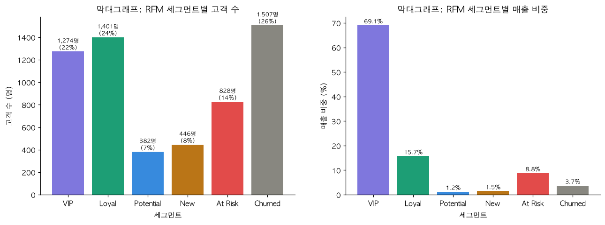

| 세그먼트 | 고객 수 (비중) | 평균 Recency | 평균 주문 수 | 평균 순 구매 금액 | 매출 비중 |
|---|---|---|---|---|---|
| VIP | 1,274명 (21.8%) | 19일 | 17.1회 | 8,869파운드 | **69.1%** |
| Loyal | 1,401명 (24.0%) | 70일 | 5.4회 | 1,837파운드 | 15.7% |
| Potential | 382명 (6.5%) | 105일 | 1.4회 | 526파운드 | 1.2% |
| New | 446명 (7.6%) | 27일 | 1.5회 | 539파운드 | 1.5% |
| At Risk | 828명 (14.2%) | 366일 | 5.0회 | 1,738파운드 | 8.8% |
| Churned | 1,507명 (25.8%) | 456일 | 1.3회 | 404파운드 | 3.7% |

세그먼트 규칙(R, F, M은 고객 순위를 5등분한 1~5점): VIP는 R·F·M 모두 4 이상, Loyal은 R·F 3 이상, New는 R 4 이상이면서 F 2 이하, At Risk는 R 2 이하이면서 F 3 이상, Churned는 R·F 모두 2 이하, 나머지는 Potential.

- 거래 한 줄의 금액은 중앙값 10.08파운드, 평균 19.58파운드다. 대량 도매 주문이 평균을 끌어올리는 오른쪽으로 긴 분포다.
- 주문 빈도와 금액은 순위 상관(Spearman) 0.86으로 강하게 함께 움직인다.
- 매출은 두 해 모두 11월이 최고다(2011년 11월 145만 파운드). 2011년 1~11월 매출의 40.5%가 9~11월에 나왔다.

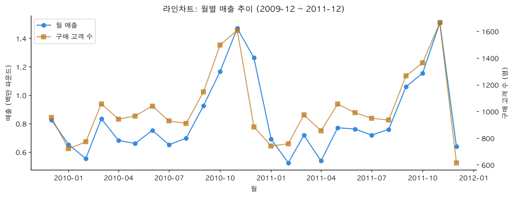

## 비즈니스 인사이트

**인사이트 1. 매출의 69%가 고객 22%(VIP)에게서 나온다**

- (근거) VIP 1,274명(전체의 21.8%)이 순 매출의 69.1%(1,130만 파운드)를 냈다. 상위 1% 고객만으로도 매출의 31.1%다(위 세그먼트별 매출 비중 막대그래프).
- (실행) VIP 대상 → 대량 구매 할인 단가, 전담 담당자, 신상품 선공개 같은 전용 혜택 → VIP 이탈을 막는다. VIP 1명이 떠나면 평균 8,869파운드(2년 순 구매 금액)를 잃는다.
- (검증) VIP 중 도매업체와 개인 고객이 얼마나 섞여 있는지 알 수 있는 고객 유형 데이터가 추가로 필요하다. 도매업체라면 할인보다 결제 조건이나 배송 혜택이 더 효과적일 수 있다.

**인사이트 2. 단골이었다가 1년 가까이 오지 않는 At Risk 고객이 828명 있다**

- (근거) At Risk 828명(14.2%)은 2년간 평균 5.0번 주문했지만, 평균 366일 동안 구매가 없다. 이 고객들의 순 구매 금액 합은 144만 파운드(매출의 8.8%)다(노트북 7장 세그먼트 표, R × F 히트맵).
- (실행) At Risk 대상 → 과거 구매 상품의 재입고·신상품 안내와 복귀 쿠폰 발송 → 이 중 10%(약 83명)만 돌아와도, 평균 순 구매 금액 1,738파운드 수준의 고객을 되찾는다.
- (검증) 반증 가능성: 도매 고객이 폐업했거나 거래처를 바꾼 것이라면 쿠폰은 효과가 없다. 이탈 사유를 알려면 고객 설문이나 경쟁사 가격 데이터가 필요하다.

**인사이트 3. 매출은 9~11월에 몰리지만, 12월 첫 구매 고객은 거의 돌아오지 않는다**

- (근거) 2011년 1~11월 매출의 40.5%가 9~11월에 나왔고, 11월 매출은 2월의 2.86배다(위 월별 매출 라인차트). 2010년 12월에 처음 산 고객 76명의 1~6개월 뒤 재구매율은 평균 7.9%로, 다른 달 코호트 평균 19.6%의 절반도 안 된다(아래 코호트 히트맵).
- (실행) 11~12월 첫 구매 고객 대상 → 첫 구매 후 30일 안에 1월용 재구매 쿠폰과 비시즌 상품 안내 발송 → 이 코호트의 재구매율을 다른 달 수준(약 20%)으로 끌어올린다. 재고와 광고는 9월 이전에 준비한다.
- (검증) 12월 첫 구매 고객이 선물을 한 번 사는 개인 고객인지는 알 수 없어, 고객 유형 데이터가 추가로 필요하다. 또 12월 코호트는 2010년 한 번만 관측했으므로(2011년 12월은 9일까지만 있음) 매년 반복되는 현상인지 다음 해 데이터로 확인해야 한다.

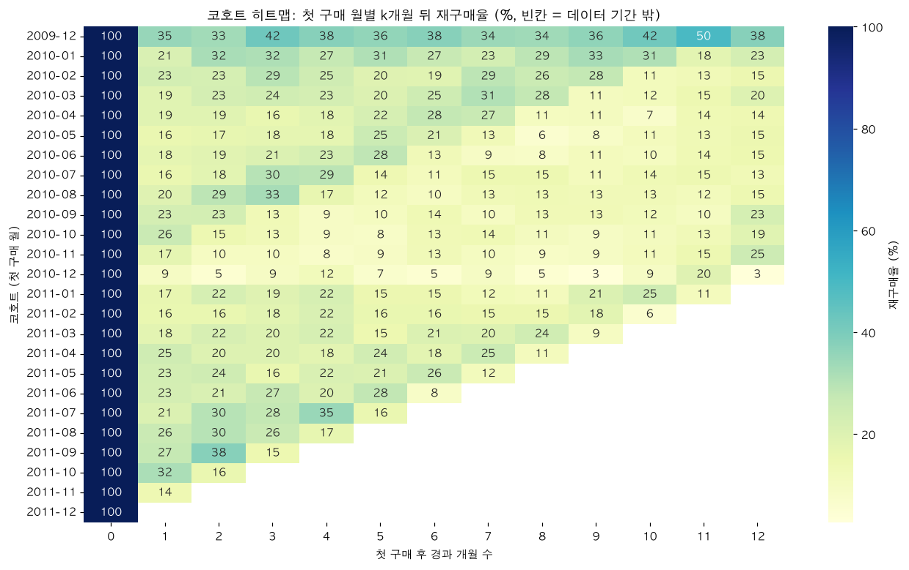

## 다음 단계: 머신러닝으로 확장

이 과제는 모델을 만들지 않는다(scikit-learn 금지). 대신 다음 머신러닝 과제에서 바로 쓸 수 있도록 **무엇을 예측하고(타깃), 무엇을 넣을지(피처)** 를 정하고, 그 표를 노트북 [9-1절](notebooks/analysis_report.ipynb)에서 실제로 만들었다.

**모델 1. 고객 이탈 예측 (거래 데이터)**

- **타깃 `churn`**: 기준일 2011-09-10 이후 마지막 90일(2011-09-10 ~ 2011-12-09)에 한 번도 사지 않으면 1, 샀으면 0.
- **대상**: 기준일 전에 한 번 이상 산 고객 5,256명. 이 중 56.4%가 `churn = 1`이다.
- **피처는 기준일 이전 거래로만 만든다.** 이후 거래를 쓰면 정답을 미리 보는 셈(**데이터 누수**)이다.

| 피처 컬럼 | 뜻 | 만드는 방법 |
|---|---|---|
| `recency_days` | 마지막 구매 후 지난 날 수 | 기준일 − 마지막 구매일 |
| `frequency` | 주문 수 | 서로 다른 `Invoice` 수 |
| `monetary` | 순 구매 금액 | 구매 금액 − 취소 금액 |
| `avg_order_value` | 주문 1번의 평균 금액 | 구매 금액 ÷ 주문 수 |
| `tenure_days` | 거래한 기간 | 기준일 − 첫 구매일 |
| `n_products` | 산 상품 종류 수 | 서로 다른 `StockCode` 수 |
| `cancel_ratio` | 취소 비율 | 취소 행 수 ÷ 전체 행 수 |
| `is_uk` | 영국 고객인지 | `Country == "United Kingdom"`이면 1 |

모델 없이 피처 하나로만 나눠 봐도 이탈 비율이 크게 다르다. 그래서 이 피처들에는 예측할 만한 신호가 있다.

| 5분위 | 1분위 | 2분위 | 3분위 | 4분위 | 5분위 |
|---|---|---|---|---|---|
| 최근성으로 나눔 (1 = 가장 최근에 산 고객) | 24.7% | 40.3% | 60.2% | 70.8% | 86.3% |
| 빈도로 나눔 (1 = 가장 적게 산 고객) | 79.2% | 74.5% | 61.4% | 47.3% | 19.9% |

다음 단계는 다섯 가지다.

1. 이 표를 학습용과 검증용으로 나눈다.
2. 피처를 스케일링한다. 꼬리가 긴 값(`monetary`, `frequency` 등)은 로그 후 표준화하고, 기준은 학습용으로만 계산한다([개념 설명 5-1](#5-1-스케일링-언제-어떤-방법을-쓰나)).
3. 로지스틱 회귀 같은 모델로 `churn`을 예측한다.
4. 이탈 비율이 56%라서 정확도만 보면 안 된다. 정밀도와 재현율을 함께 본다.
5. 모델이 고른 이탈 위험 고객에게 쿠폰을 보내는 A/B 실험으로 실제 효과를 검증한다.

**모델 2. 상품 카테고리 예측 (상품 데이터: 이미지·텍스트 피처)**

거래 데이터와 상품 데이터는 연결 키가 없어서(다른 회사 데이터), 이미지·텍스트 피처는 이탈 모델에 넣을 수 없다. 대신 상품 데이터 안에서 쓴다.

- **타깃**: `masterCategory` (Apparel, Accessories, Footwear 등)
- **피처**:
  - 이미지: `img_mean`, `img_std`, `edge_strength`, `dark_ratio`, `white_ratio` (밝기 히스토그램 8구간에서 만든 비율)
  - 텍스트: `name_word_count`, `name_char_length`
- 이 피처들은 컴퓨터 비전(A3), 자연어 처리(A4) 과제에서 신경망이 직접 배우는 피처와 비교하는 기준선이 된다.

## 실행 증거: 노트북과 결과 파일

노트북은 **실행한 상태 그대로**(출력과 그림 포함) 저장했다. GitHub에서 [notebooks/analysis_report.ipynb](notebooks/analysis_report.ipynb)를 열면 실행 결과를 바로 볼 수 있다.

- **실행 기록**: [outputs/run_log.txt](outputs/run_log.txt)
  - 실행 명령, 시작·끝 시각, 라이브러리 버전
  - 코드 셀 56개가 1번부터 56번까지 순서대로 실행됐고, **에러 출력 0개**, 노트북 안 그림 11장
- **노트북 안에서 바로 확인할 수 있는 표**:
  - 데이터 shape와 dtypes (`info()`, 1-1절)
  - 피처를 만든 뒤의 상위 행 (4-1, 4-2절)
  - `summary_stats`, `correlations` 결과 (6-1절, 8절)
  - 세그먼트별 요약 (7절)

**6종 차트와 결과 파일** (모든 차트에 제목과 축 레이블이 있다)

| 차트 유형 | 파일 | 무엇을 그렸나 | 노트북 절 |
|---|---|---|---|
| 히스토그램 | [histograms.png](outputs/histograms.png) | 거래 금액(로그), 이미지 밝기 평균·표준편차의 분포 | 6-1 |
| 박스플롯 | [outlier_before_after.png](outputs/outlier_before_after.png) | 거래 금액의 이상치 처리 전후 (+ 히스토그램) | 5-2 |
| 막대그래프 | [rfm_segments_bar.png](outputs/rfm_segments_bar.png), [product_scatter_bar.png](outputs/product_scatter_bar.png) | 세그먼트별 고객 수·매출 비중, 상품 카테고리 빈도 | 7, 8 |
| 히트맵 | [correlation_heatmaps.png](outputs/correlation_heatmaps.png), [rfm_heatmap_scatter.png](outputs/rfm_heatmap_scatter.png) | 상관행렬, R × F 점수별 고객 수 | 8, 7 |
| 산점도 | [rfm_heatmap_scatter.png](outputs/rfm_heatmap_scatter.png), [product_scatter_bar.png](outputs/product_scatter_bar.png) | 빈도 × 금액(세그먼트 색), 이미지 밝기 평균 × 표준편차 | 7, 8 |
| 라인차트 | [monthly_revenue.png](outputs/monthly_revenue.png) | 월별 매출과 고객 수 | 6-2 |
| 막대그래프 + 히스토그램 | [scaling_methods.png](outputs/scaling_methods.png) | 스케일링 방법별로 R·F·M이 고객 간 거리에서 차지하는 비중, Monetary 분포 | 8-1 |
| (그 밖) | [image_feature_examples.png](outputs/image_feature_examples.png), [bonus_image_features.png](outputs/bonus_image_features.png), [bonus_cohort_heatmap.png](outputs/bonus_cohort_heatmap.png), [rfm_interactive.html](outputs/rfm_interactive.html) | 이미지 피처 예시, 보너스 1·2·3 | 4-1, 10 |

**이상치 처리 전후 박스플롯** (5-2절)

- 왼쪽 박스플롯: 처리 전에는 경계(38.06파운드) 위로 점이 168,469파운드까지 이어진다. 처리 후(clip)에는 모든 값이 경계 안에 있다.
- 오른쪽 히스토그램: 잘라 붙인 값이 경계에 모여 막대 하나가 솟았다. clip이 행은 남기고 값만 당긴다는 뜻이다.

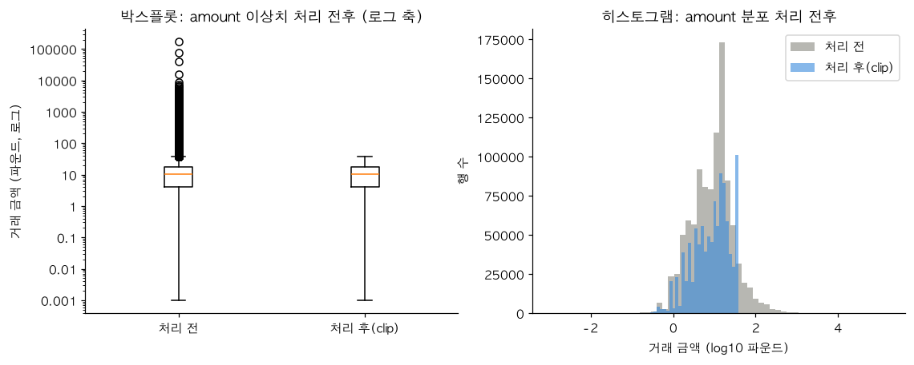

## 0. 큰 그림: 데이터 분석은 AI의 어디에 있나

AI 모델은 데이터에서 배운다. 그런데 현실의 데이터는 빠진 값, 잘못 들어간 값, 서로 다른 형태(숫자·글·사진)가 뒤섞여 있다. 모델을 만들기 전에 **데이터를 들여다보고, 고치고, 숫자로 바꾸는 일**이 먼저 필요하다. 이 과제는 그 첫 단계를 처음부터 끝까지 해 보는 과제다.

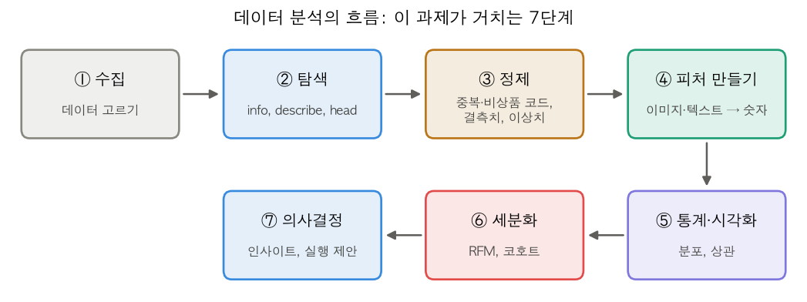

| 단계 | 하는 일 | 이 과제의 요구사항 | 이 문서에서 설명하는 곳 |
|---|---|---|---|
| ① 수집 | 조건에 맞는 데이터를 고르고 출처·라이선스를 확인한다 | 할 일 1 | [데이터셋 후보](#데이터셋-후보), [데이터 설명](#데이터-설명) |
| ② 탐색 | 행·열 수, 자료형, 값의 범위를 훑어본다 | 할 일 1 | [개념 설명 1](#1-탐색-먼저-들여다본다) |
| ③ 정제 | 중복·비상품 기록을 빼고, 빈 값을 채우고, 튀는 값을 찾는다 | 할 일 4 | [개념 설명 1-1](#1-1-전처리-기준-무엇을-빼고-무엇을-남기나), [2](#2-결측치-왜-비었는지부터-생각한다), [3](#3-이상치-지우기-전에-정체부터-본다) |
| ④ 피처 만들기 | 사진과 글을 계산할 수 있는 숫자 열로 바꾼다 | 할 일 3 | [개념 설명 4](#4-피처-엔지니어링-숫자가-아닌-것을-숫자로) |
| ⑤ 통계·시각화 | 대표값, 퍼짐, 두 변수의 관계를 재고 그린다 | 할 일 5, 6 | [개념 설명 5, 6](#5-통계와-상관-요약하고-관계를-잰다) |
| ⑥ 세분화 | 비슷한 고객끼리 묶는다 | 할 일 7, 보너스 2 | [개념 설명 7, 8](#7-rfm-누가-단골인가) |
| ⑦ 의사결정 | 숫자를 근거로 "누구에게 무엇을 할지" 제안한다 | 할 일 8 | [비즈니스 인사이트](#비즈니스-인사이트) |

**이후 과제와의 연결**: 여기서 만든 이미지 평균·표준편차 같은 피처는 컴퓨터 비전(A3) 과제의 출발점이고, 상품명 단어 수 같은 텍스트 피처는 자연어 처리(A4)로, 결측치·이상치 처리와 고객 데이터 다루기는 머신러닝(A5) 과제로 이어진다.

### 배경과 역사: 이 과제의 도구들은 어디서 왔나

| 시기 | 사건 | 이 과제에서 쓰는 곳 |
|---|---|---|
| 1880년대 ~ 1904 | Galton이 두 변수가 함께 변하는 정도를 재는 아이디어를 내고, Karl Pearson이 1896년 지금의 **Pearson 상관계수**로 정리했다. 1904년 Charles Spearman이 순위로 재는 **Spearman 순위 상관계수**를 발표했다 | 상관 분석 (할 일 5) |
| 1890년대 ~ 1940년대 | Vilfredo Pareto가 이탈리아 토지의 약 80%를 인구 약 20%가 가진다는 관찰을 남겼다. 품질 관리 전문가 Joseph Juran이 이 패턴을 "중요한 소수"로 일반화하며 **파레토 법칙**이라 불렀다 | VIP 22%가 매출 69% (인사이트 1) |
| 1965 | 인구학자 Norman Ryder가 "같은 시기에 같은 일을 겪은 집단"인 **코호트**를 사회 변화 연구의 단위로 제시했다. 이후 마케팅의 고객 유지율 분석으로 퍼졌다 | 코호트 분석 (보너스 2) |
| 1970 ~ 1977 | John Tukey가 "가설을 세우기 전에 먼저 데이터를 들여다보라"는 **탐색적 데이터 분석(EDA)** 을 주장했다. 박스플롯을 1970년 무렵 처음 소개했고 1977년 책 *Exploratory Data Analysis*로 널리 알렸다. 이상치 경계의 **1.5 × IQR** 규칙도 Tukey에게서 나왔다 | EDA 전체, 박스플롯, IQR 이상치 (할 일 1, 4, 6) |
| 1976 | Donald Rubin이 "값이 왜 비었는가"에 따라 결측을 구분하는 틀을 제시했다. 지금 쓰는 MCAR, MAR, MNAR 분류의 출발점으로 꼽힌다 | 결측치 처리 (할 일 4) |
| 1990년대 | 우편 카탈로그 회사들이 "누구에게 카탈로그를 보내야 주문이 올까"를 고르려고 최근성·빈도·금액으로 고객을 나눴다. 1994년 Arthur Hughes의 책이 각 기준을 5단계로 나누는 방식을 소개했고, 1995년 Bult와 Wansbeek가 이를 통계 모델로 다뤘다. 누가 처음 만들었는지는 출처마다 다르다 | **RFM** (할 일 7) |
| 2006 | Travis Oliphant가 둘로 갈라져 있던 Python 배열 라이브러리(Numeric, Numarray)를 합쳐 **NumPy 1.0**을 냈다 | 이미지 배열, 벡터 연산 (할 일 3) |
| 2008 ~ 2009 | Wes McKinney가 금융 회사에서 표 데이터를 빠르게 다루려고 **pandas**를 만들기 시작했고, 2009년 오픈소스로 공개했다 | 표 데이터 전체 |

**공통된 흐름**: 이 도구들은 대부분 "데이터가 생각보다 지저분하고 고르지 않다"는 문제에서 나왔다. Tukey는 평균만 보지 말고 분포 전체를 그려 보라고 했고, Spearman은 극단값에 흔들리지 않는 상관을 찾았고, Pareto와 RFM은 "모든 고객이 같지 않다"는 사실을 다뤘다. 이 과제의 데이터(대량 도매 주문, 취소, 비회원 구매)가 바로 그런 데이터다.

### 추천 학습 순서

| 순서 | 주제 | 무엇을 이해하나 | 이 문서 |
|---|---|---|---|
| 1 | 대표값과 퍼짐 | 평균과 중앙값이 왜 다를 수 있나, 표준편차, 사분위수 | [수학·통계 준비 1~3](#수학통계-준비-숫자로-먼저-이해하기) |
| 2 | 박스플롯과 IQR | 상자와 수염이 뜻하는 것, 이상치 경계 | 수학·통계 준비 3, [개념 설명 3](#3-이상치-지우기-전에-정체부터-본다) |
| 3 | 로그 축 | 꼬리가 긴 데이터를 보기 좋게 그리는 법 | 수학·통계 준비 4 |
| 4 | 상관계수 | Pearson과 Spearman의 차이 | 수학·통계 준비 5, [개념 설명 5](#5-통계와-상관-요약하고-관계를-잰다) |
| 5 | 배열과 이미지 | 이미지가 숫자 표인 이유, 축(axis), 벡터 연산 | 수학·통계 준비 6, 7, [개념 설명 4](#4-피처-엔지니어링-숫자가-아닌-것을-숫자로) |
| 6 | 결측치와 그룹 대치 | 값이 빈 이유, groupby로 채우기 | [개념 설명 2](#2-결측치-왜-비었는지부터-생각한다) |
| 7 | RFM과 코호트 | 분위 점수, 세그먼트 규칙, 재구매율 | 수학·통계 준비 8, [개념 설명 7, 8](#7-rfm-누가-단골인가) |
| 8 | 인사이트 쓰기 | 근거·실행·검증 | [비즈니스 인사이트](#비즈니스-인사이트) |

공식과 숫자 예시만 모아 둔 학습 가이드는 [STUDY.md](STUDY.md)에 있다.

## 학습 목표

과제를 마치면 아래를 스스로 설명할 수 있어야 한다. (명세 "과제 목표")

- NumPy의 벡터 연산(Vectorization)을 활용하여 반복문 없이 배열 데이터를 처리하는 방법
- 이미지 데이터에서 평균, 표준편차 등 통계적 특성을 추출하여 수치형 피처로 변환하는 원리
- IQR 방식을 활용한 이상치 탐지 로직을 직접 구현하고 그 원리를 설명하기
- RFM 분석을 통해 고객을 세분화하고, 데이터 기반의 비즈니스 전략을 제안하기
- 분석 로직을 Class로 구조화하여 재사용 가능한 코드를 설계하는 방법

## 최종 결과물

GitHub 레포지토리 URL로 제출한다.

| 결과물 | 경로 | 포함할 내용 | 상태 |
|---|---|---|---|
| 데이터 분석 파이프라인 모듈 | `src/pipeline.py` | 원본 데이터를 입력받아 전처리, 피처 엔지니어링, 요약 통계를 수행하는 Python Class. 절차 지향 스크립트가 아닌 객체 지향(OOP) 구조 | ✅ |
| 분석 리포트 노트북 | `notebooks/analysis_report.ipynb` | 전처리 결과 시각화, 통계 분석, RFM 기반 고객 세분화 결과. 주요 분석 단계마다 마크다운 설명 | ✅ |
| README.md | `README.md` | 프로젝트 개요, 데이터 설명, 비즈니스 인사이트 3가지 이상, 실행 방법 | ✅ |

## 프로젝트 구조

```
codyssey_A1-1/
├── src/
│   ├── pipeline.py              # DataAnalyzer 클래스: 로드, 결측치·이상치, 이미지·텍스트 피처, 통계, RFM, 코호트
│   └── plot_style.py            # 그림 공통 설정 (한글 글꼴, outputs/ 저장)
├── notebooks/
│   └── analysis_report.ipynb    # 분석 리포트: EDA, 통계, 6종 시각화, RFM 세분화, 인사이트, 보너스
├── scripts/
│   └── download_data.py         # 데이터 내려받기 (표준 라이브러리만 사용)
├── outputs/                     # 노트북이 저장한 그림 11장 + 인터랙티브 차트(rfm_interactive.html) + 실행 기록(run_log.txt)
├── data/                        # 원본 데이터. 용량과 라이선스 때문에 git에서 제외
├── docs/
│   ├── A1-1.pdf                 # 과제 명세
│   └── figures/                 # README 개념 설명용 그림과 생성 스크립트 (가상 데이터)
├── pyproject.toml, uv.lock      # uv 프로젝트 설정
├── README.md
└── STUDY.md                     # 학습 가이드: 공식, 숫자 예시, 공부 순서
```

## 개발 환경과 제약 사항

**개발 환경**

- Python 3.8 이상
- 허용 라이브러리: NumPy, Pandas, Matplotlib, Seaborn
- 보너스 과제 3에 한하여 Plotly 사용을 예외적으로 허용한다.

**금지 사항**

- OpenCV, Pillow 등 이미지 처리 전용 라이브러리 사용 금지. NumPy 배열 연산으로 직접 구현한다.
- Scikit-learn, NLTK 등 머신러닝/자연어처리 라이브러리 사용 금지.
- 자동 EDA 라이브러리(pandas-profiling, sweetviz 등) 사용 금지.

**이미지 처리 허용 범위**

- 이미지 입력/변환: `imread()` 사용 가능. 반환되는 NumPy 배열을 직접 조작한다.
- 저장/복구: CSV에 배열이 문자열로 저장되는 경우 `fromstring()` 또는 `ast.literal_eval()`로 복구한다.
- 리사이즈: NumPy 슬라이싱(`arr[::n, ::n]`)으로 단순 다운샘플링을 수행한다.

**Pillow 사용 기준 (명세 해석)**

Matplotlib 3.11의 `plt.imread()`는 PNG를 포함한 모든 이미지 파일을 내부적으로 Pillow로 디코딩한다. 그래서 "Pillow가 쓰였느냐"가 아니라 **Pillow로 무엇을 하느냐**로 판단한다. 명세가 막으려는 것은 이미지를 다루는 계산을 라이브러리에 맡기는 것이다("NumPy 배열 연산으로 직접 구현한다", "반환되는 NumPy 배열을 직접 조작한다"). 파일을 숫자 배열로 바꾸는 입구까지만 라이브러리를 쓰고, 그 뒤의 계산은 모두 NumPy로 한다.

| 쓰임 | 예 | 판단 |
|---|---|---|
| 파일 → 배열 디코딩 (Matplotlib을 통해) | `plt.imread(path)` | 허용으로 본다. 명세가 직접 허용한 함수이고, Pillow는 압축을 푸는 데만 쓰인다 |
| 파일 → 배열 디코딩 (Pillow 직접 호출) | `np.array(Image.open(path))` | 회색 지대. 하는 일은 같지만 금지 라이브러리를 직접 `import`하므로 쓰지 않는다 |
| 크기 바꾸기 | `Image.resize()`, `thumbnail()` | 금지. NumPy 슬라이싱 `arr[::n, ::n]`으로 한다 |
| 흑백 변환, 자르기 | `convert('L')`, `crop()` | 금지. `img[..., :3] @ [0.299, 0.587, 0.114]`, `img[y1:y2, x1:x2]`로 한다 |
| 필터, 통계 | `ImageFilter`, `ImageStat` | 금지. 평균·표준편차는 `np.mean`, `np.std`로 직접 계산한다 |

지키는 방법:

- 이미지 읽기는 `plt.imread()`만 쓰고, 다운샘플링·흑백 변환·통계는 모두 NumPy로 한다.
- 코드에 Pillow를 직접 쓰지 않았는지 `grep -rn "PIL" src notebooks`로 확인한다(아무것도 나오지 않아야 한다).
- 리포트에 근거를 한 줄 남긴다. 예: "이미지는 명세가 허용한 `plt.imread()`로만 읽었다. 이 함수는 내부적으로 Pillow로 파일을 디코딩하지만, 코드에서 Pillow를 직접 import하거나 그 처리 기능을 쓰지 않았다."
- `plt.imread()`는 PNG를 0~1 실수(float)로, JPG 등 다른 형식은 정수(보통 0~255의 uint8)로 돌려준다. 형식이 섞이면 평균·표준편차 피처의 단위가 달라지므로 하나로 맞춘다(예: JPG 배열을 255로 나누기).
- 가장 확실한 것은 운영진 확인이다([명세에서 확인할 점](#명세에서-확인할-점) 참고).

**데이터셋 조건**

- Kaggle, AI Hub 등에서 이커머스/상품 관련 데이터를 수집하거나 제공된 샘플을 사용한다.
- 이미지 데이터는 NumPy 배열 형태로 변환하여 사용한다.
- 공개 라이선스(CC-BY, MIT 등) 데이터를 우선 사용하고, 출처를 반드시 명시한다.

## 데이터셋 후보

명세의 데이터 조건을 채울 수 있는 공개 데이터셋을 조사한 결과다(2026-11-23 기준). 라이선스는 "확인"이라고 적은 것만 원문 페이지에서 직접 확인했다.

**명세가 데이터에 요구하는 것**

| 필요한 것 | 어디서 필요한가 |
|---|---|
| 1,000건 이상, 컬럼 8개 이상 | 할 일 1 |
| 수치형, 범주형, 날짜형, 이미지(배열) 중 3가지 이상 | 할 일 1 |
| 이미지 배열 (평균·표준편차 피처) | 할 일 3 |
| 상품명 텍스트 (단어 수 피처) | 할 일 3 |
| 거래 데이터: `customer_id`, `order_date`, `amount`(또는 price × qty) | 할 일 1, 7 (RFM) |
| 공개 라이선스(CC-BY, MIT 등) 우선, 출처 명시 | 데이터셋 조건 |

### 먼저 확인할 것: 제공 샘플

명세는 "수집하거나 **제공된 샘플**을 사용한다"고 한다. 과정에서 주는 샘플 데이터가 있으면 그것이 조건을 가장 확실하게 만족한다. 운영진에게 먼저 확인한다.

### 추천 조합 A: Online Retail II + Fashion Product Images (Small)

하나의 공개 데이터셋으로는 거래, 상품명, 이미지를 모두 갖춘 것을 찾지 못했다. 그래서 역할을 나눠 두 개를 쓴다.

| 역할 | 데이터셋 | 라이선스 | 규모 |
|---|---|---|---|
| 거래, RFM, 가격·날짜 분석 | [UCI Online Retail II](https://archive.ics.uci.edu/dataset/502/online+retail+ii) | CC BY 4.0 (확인) | 1,067,371건, 컬럼 8개 (2009-12 ~ 2011-12, 영국 온라인 선물용품 쇼핑몰) |
| 상품 이미지, 상품명, 카테고리 | [Fashion Product Images (Small)](https://www.kaggle.com/datasets/paramaggarwal/fashion-product-images-small) | MIT (확인) | 상품 약 4.4만 개, `styles.csv` 컬럼 10개 + 작은 JPG 이미지 |

| 요구사항 | 해결 방법 |
|---|---|
| RFM (할 일 7) | Online Retail II의 `Customer ID`, `InvoiceDate`, `Quantity × Price` |
| 결측치 대치 (할 일 4) | Online Retail II는 `Customer ID`가 빈 행이 많다(OpenML 미러 기준 24만여 건). `Price`·`Description` 등도 그룹별 대치 대상으로 살펴본다 |
| IQR 이상치 (할 일 4) | 취소 주문(송장 번호가 `C`로 시작)은 수량이 음수이고, 대량 도매 주문은 극단값이라 연습하기 좋다 |
| 통계·상관 분석 (할 일 5) | `Quantity`, `Price`, 매출. 상품 쪽은 이미지 평균·표준편차, 상품명 단어 수 |
| 6종 시각화 (할 일 6) | 라인차트는 월별 매출, 막대그래프는 카테고리 빈도나 세그먼트별 고객 수 |
| 이미지·텍스트 피처 (할 일 3) | Fashion 이미지 → 평균·표준편차, `productDisplayName` → 단어 수 |
| 코호트 분석 (보너스 2) | 가입일이 없으므로 **첫 구매 월**을 가입 월 대신 쓴다 (명세에서 확인할 점 참고) |

**약점**: 두 데이터셋은 서로 다른 회사의 데이터라 상품이 연결되지 않는다. "상품 데이터 분석"과 "고객 거래 분석"을 두 흐름으로 나누고, 그렇게 나눈 이유를 리포트에 밝힌다.

### 추천 조합 B: 이미지 읽기 문제를 피하고 싶을 때

조합 A의 이미지 대신 [Fashion-MNIST](https://github.com/zalandoresearch/fashion-mnist)(MIT, Zalando)를 쓴다. 28×28 흑백 의류 이미지 70,000장과 10종 라벨이 바이너리(ubyte) 또는 CSV 형태로 있어서, **`imread()` 없이 바로 NumPy 배열로 읽을 수 있다.** 대신 상품명 텍스트가 없으므로 텍스트 피처는 Online Retail II의 `Description`(상품명)으로 만든다.

### 후보 전체 비교

| 데이터셋 | 라이선스 | 거래 | 상품명 | 이미지 | 판단 |
|---|---|---|---|---|---|
| [UCI Online Retail II](https://archive.ics.uci.edu/dataset/502/online+retail+ii) | CC BY 4.0 (확인) | O | O | X | **거래·RFM용 1순위** |
| [UCI Online Retail](https://archive.ics.uci.edu/dataset/352/online+retail) | CC BY 4.0 | O | O | X | 위 데이터의 2010~2011년 부분(약 54만 건). 더 가볍게 하려면 이것 |
| [Fashion Product Images (Small)](https://www.kaggle.com/datasets/paramaggarwal/fashion-product-images-small) | MIT (확인) | X | O | O (JPG) | **이미지·상품명용 1순위** |
| [Fashion-MNIST](https://github.com/zalandoresearch/fashion-mnist) | MIT | X | X | O (배열) | 이미지를 배열로 바로 쓰고 싶을 때 |
| [Amazon Berkeley Objects (ABO)](https://amazon-berkeley-objects.s3.amazonaws.com/index.html) | CC BY 4.0 (확인) | X | O (다국어, 한국어 포함) | O (JPG, 최대 256px 묶음 3GB) | 상품 14.8만 개. 가격이 없다. 이미지·상품명 대안 |
| [Amazon Reviews 2023](https://amazon-reviews-2023.github.io/) | 명시 없음 | 리뷰 (구매 아님) | O | 이미지 URL만 | 사용자·시간·가격·상품명·이미지가 모두 연결되지만, 라이선스가 없고 이미지를 Amazon 서버에서 따로 받아야 한다 |
| [H&M Personalized Fashion Recommendations](https://www.kaggle.com/competitions/h-and-m-personalized-fashion-recommendations/data) | 비상업·학술 연구 한정 (확인) | O | O | O | 모든 것이 연결된 유일한 후보지만 공개 라이선스가 아니고, 대회 규칙에 동의해야 받을 수 있다. 공개 레포에 데이터를 올리면 안 된다 |
| [Olist Brazilian E-Commerce](https://www.kaggle.com/datasets/olistbr/brazilian-ecommerce) | CC BY-NC-SA 4.0 (2차 출처) | O | X (이름 **길이**만) | X | 상품명 텍스트와 이미지가 없어 부적합 |
| [Retailrocket](https://www.kaggle.com/datasets/retailrocket/ecommerce-dataset) | 불명확 | 행동 로그 | X (해시 처리) | X | 값이 모두 해시 처리되어 부적합 |
| [AI Hub](https://aihub.or.kr) | 데이터별 약관 | 데이터별 | 데이터별 | 패션 이미지 다수 | 회원가입과 사용 신청이 필요하고 재배포가 제한된다. 쓰려면 데이터셋 페이지의 약관을 따로 확인한다 |
| 직접 만든(합성) 거래 데이터 | - | O | 상품 데이터에서 | 상품 데이터에서 | 이미지 상품 카탈로그에 NumPy로 만든 고객·거래를 붙이면 모든 것이 연결된다. 다만 명세의 "수집하거나 제공된 샘플"에 해당하는지 운영진 확인이 필요하다 |

### 데이터를 다룰 때 주의할 점

- **데이터 파일은 레포에 올리지 않는다.** 이 레포는 공개 상태이고 파일도 크다(Online Retail II 엑셀만 43.5MB). `data/` 폴더에 두고 `.gitignore`로 제외한다. README에는 다운로드 위치와 출처, 라이선스만 적는다.
- **출처 표기**: CC BY 4.0과 MIT 모두 출처와 라이선스를 밝혀야 한다. 예: `Chen, D. (2012). Online Retail II [Dataset]. UCI Machine Learning Repository. https://doi.org/10.24432/C5CG6D`
- **JPG 이미지와 `imread()`**: `plt.imread()`는 내부적으로 Pillow를 쓴다. 어디까지 허용되는지는 [개발 환경과 제약 사항](#개발-환경과-제약-사항)의 "Pillow 사용 기준"을 따른다. 이 문제를 아예 피하려면 조합 B처럼 처음부터 배열 형태인 이미지를 쓴다.
- **이미지 크기 맞추기**: 이미지마다 크기가 다르면 명세가 허용하는 NumPy 슬라이싱(`arr[::n, ::n]`)으로 줄이거나 같은 크기로 잘라서 배열 하나로 쌓는다.

## 실행 방법

**1. 환경 준비** ([uv](https://docs.astral.sh/uv/) 사용. 분석은 Python 3.13에서 확인했다)

```bash
uv sync
```

설치되는 패키지는 과제 허용 라이브러리 NumPy, Pandas, Matplotlib, Seaborn과, 보너스 3 전용 Plotly다. Jupyter와 nbconvert는 노트북 실행용 개발 도구다.

**2. 데이터 내려받기** (data/ 에 저장, 약 150MB)

```bash
uv run python scripts/download_data.py
```

- UCI Online Retail II zip을 받아 엑셀을 CSV로 바꾼다. 허용 라이브러리 밖의 `openpyxl`을 쓰지 않으려고, 엑셀 파일(XML을 zip으로 묶은 형식)을 표준 라이브러리 `zipfile`과 XML 파서로 직접 읽는다.
- Fashion Product Images (Small)는 원본 Kaggle이 로그인이 필요해서, 같은 데이터의 Hugging Face 미러에서 상품 2,000개(시드 42로 고른 20묶음)와 이미지를 받는다. 서버가 잠시 막으면(503) 기다렸다가 다시 시도하며, 이미 받은 이미지는 건너뛴다.

**3. 분석 노트북 실행**

```bash
cd notebooks && uv run jupyter nbconvert --to notebook --execute --inplace analysis_report.ipynb
```

또는 `uv run jupyter lab`으로 열어 위에서부터 실행한다. 그림은 `outputs/`에 저장된다. 이 저장소에 올린 노트북은 이 명령으로 실행한 결과이고, 실행 기록은 [outputs/run_log.txt](outputs/run_log.txt)에 있다(약 40초).

**4. README 개념 그림 다시 만들기** (선택, 데이터 없이 실행된다)

```bash
uv run python docs/figures/make_figures.py
```

## 수학·통계 준비: 숫자로 먼저 이해하기

이 절의 그림은 개념을 보여 주려고 만든 **가상의 값**이다(`docs/figures/make_figures.py`). 실제 분석 결과는 `outputs/`에 있다.

### 1) 평균과 중앙값: "보통"을 뜻하는 두 가지 방법

- **평균(mean)**: 모두 더해서 개수로 나눈 값
- **중앙값(median)**: 크기순으로 줄 세웠을 때 한가운데 값

주문 금액이 2, 3, 3, 4, 88이라고 하자.

| | 계산 | 결과 |
|---|---|---|
| 평균 | (2 + 3 + 3 + 4 + 88) ÷ 5 | **20** |
| 중앙값 | 줄 세운 2, 3, **3**, 4, 88의 가운데 | **3** |

88 하나 때문에 평균은 20이 됐지만, 5건 중 4건은 4 이하다. 이렇게 **큰 값 몇 개가 끼어 있으면 평균은 크게 흔들리고 중앙값은 거의 그대로다.** 이 과제의 거래 금액도 평균 19.58파운드, 중앙값 10.08파운드로 같은 모양이다.

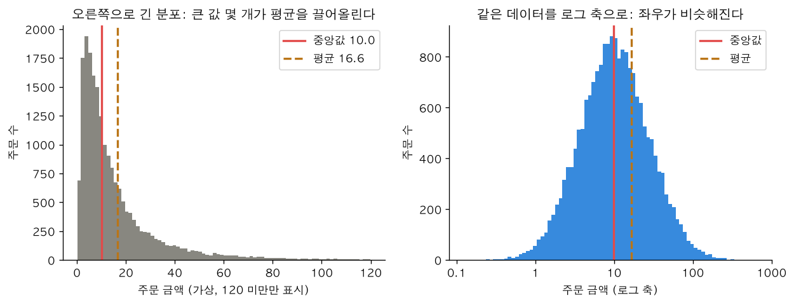

오른쪽으로 꼬리가 긴 분포(큰 값 쪽으로 길게 늘어진 분포)에서는 늘 평균 > 중앙값이 된다. 그래서 "보통 고객은 얼마를 쓰나"는 중앙값으로 말하는 것이 정직하다.

### 2) 분산과 표준편차: 얼마나 퍼져 있나

**표준편차(standard deviation)** 는 "값들이 평균에서 보통 얼마나 떨어져 있나"를 나타낸다.

```math
\text{분산} = \frac{1}{n}\sum_{i=1}^{n} (x_i - \bar{x})^2, \qquad \text{표준편차} = \sqrt{\text{분산}}
```

값이 2, 4, 4, 4, 5, 5, 7, 9라면 평균은 5다.

| 값 | 2 | 4 | 4 | 4 | 5 | 5 | 7 | 9 |
|---|---|---|---|---|---|---|---|---|
| 평균과의 차이 | −3 | −1 | −1 | −1 | 0 | 0 | 2 | 4 |
| 차이의 제곱 | 9 | 1 | 1 | 1 | 0 | 0 | 4 | 16 |

제곱의 평균(분산)은 32 ÷ 8 = 4, 표준편차는 √4 = **2**다. 차이를 그냥 더하면 +와 −가 지워져 0이 되므로 제곱해서 더한다.

(pandas의 `std()`는 n 대신 n − 1로 나누는 "표본 표준편차"를 기본으로 쓴다. 표본이 클수록 차이는 무시할 만큼 작다.)

### 3) 사분위수, IQR, 박스플롯

데이터를 크기순으로 세우고 4등분하는 세 지점을 **사분위수(quartile)** 라고 한다.

- **Q1(1사분위수)**: 아래에서 25% 지점
- **Q2**: 50% 지점 = 중앙값
- **Q3(3사분위수)**: 아래에서 75% 지점
- **IQR(사분위 범위)** = Q3 − Q1. 가운데 50%가 퍼진 폭이다.

값이 1, 2, 3, 4, 5, 6, 7, 8, 30이면 Q1 = 3, 중앙값 = 5, Q3 = 7, IQR = 4다. Tukey의 규칙으로 경계를 정하면

```math
\text{하한} = Q1 - 1.5 \times IQR = 3 - 6 = -3, \qquad \text{상한} = Q3 + 1.5 \times IQR = 7 + 6 = 13
```

이고, 30은 상한 13 밖이므로 **이상치**다. 평균·표준편차와 달리 사분위수는 30이 300이 되어도 거의 변하지 않아서, 이상치를 찾는 기준 자체가 이상치에 흔들리지 않는다.

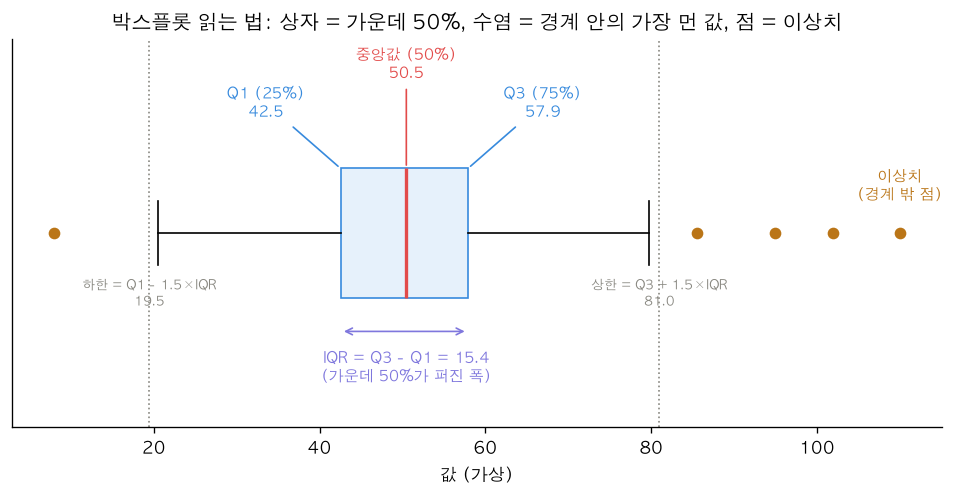

**왜 하필 1.5배인가**: Tukey가 정한 값이고, 그 이유를 자세히 남기지는 않았다. 다만 데이터가 정규분포(가운데가 볼록한 종 모양)라면 1.5 × IQR 경계는 평균에서 표준편차의 약 2.7배 지점이고, 이 밖에 있는 값은 전체의 약 0.7%뿐이다. "정상적인 데이터라면 거의 안 나오는 값"을 표시하는 기준인 셈이다. 이 과제의 금액처럼 꼬리가 긴 데이터에서는 8%가 넘게 걸린다(개념 설명 3).

### 4) 로그와 로그 축: 10배씩 커지는 값을 한 그림에

**로그(log₁₀)** 는 "10을 몇 번 곱했나"다. log₁₀(10) = 1, log₁₀(100) = 2, log₁₀(1000) = 3이다. 값이 10배 커질 때 로그는 1씩만 커진다.

거래 금액은 0.001파운드부터 168,469파운드까지 1억 배 넘게 차이 난다. 보통 축으로 그리면 거의 모든 점이 왼쪽 끝에 몰린다. **로그 축**으로 그리면 1, 10, 100, 1000이 같은 간격이 되어 전체 모양이 보인다(위 평균·중앙값 그림의 오른쪽). 이 과제의 히스토그램, 박스플롯, RFM 산점도에서 로그 축을 쓴 이유다.

### 5) 상관계수: 두 변수가 함께 움직이는 정도

**상관계수는 무엇을 재나**: "x가 클 때 y도 큰가?"를 숫자 하나로 나타낸다. 범위는 −1 ~ 1이다.
- **1에 가까우면**: 하나가 크면 다른 것도 크다 (함께 움직임)
- **−1에 가까우면**: 하나가 크면 다른 것은 작다 (반대로 움직임)
- **0 근처면**: 한쪽 값을 알아도 다른 쪽 값을 짐작할 수 없다

**숫자로 만들어 보기**: x = (1, 2, 3), y = (2, 4, 7)로 "함께 움직이는 정도"를 직접 만든다.

1. **평균과 비교한다.** x의 평균은 2, y의 평균은 4.33이다. 평균과의 차이는 x가 (−1, 0, 1), y가 (−2.33, −0.33, 2.67)이다.
2. **두 차이를 곱한다.** (−1) × (−2.33) = 2.33, 0 × (−0.33) = 0, 1 × 2.67 = 2.67.
   - 둘 다 평균보다 크거나 둘 다 작으면 곱이 **+** 다(함께 움직임).
   - 한쪽만 크면 곱이 **−** 다(반대로 움직임).
3. **곱을 모은다.** 2.33 + 0 + 2.67 = 5.0. 이것을 (개수 − 1)로 나눈 2.5가 **공분산**(covariance)이다. +면 함께, −면 반대로 움직인다는 뜻이다.
4. **단위를 없앤다.** 공분산은 단위에 따라 크기가 바뀐다.
   - y를 파운드가 아니라 펜스(×100)로 적으면, 관계는 그대로인데 공분산은 250이 된다.
   - 그래서 두 변수의 표준편차(1과 2.517)로 나눠 단위를 없앤다. 2.5 ÷ (1 × 2.517) = **0.99**. 이것이 **Pearson 상관계수**다.

```math
r = \frac{\sum (x_i - \bar{x})(y_i - \bar{y})}{\sqrt{\sum (x_i - \bar{x})^2}\sqrt{\sum (y_i - \bar{y})^2}}
```

다른 말로 하면, **Pearson 상관계수는 두 변수를 각각 표준화([9) 스케일링](#9-스케일링-단위가-다른-값을-같은-눈금으로))한 뒤 곱해서 평균 낸 값**이다.
- 표준화하면 x는 (−1, 0, 1), y는 (−0.93, −0.13, 1.06)이 된다.
- 곱은 0.93 + 0 + 1.06 = 1.99이고, (3 − 1)로 나누면 0.99로 같다.
- 단위를 처음부터 없애고 계산하므로, 파운드든 펜스든 값이 같다.

**값을 읽는 법**: 흔히 쓰는 대략의 기준(Cohen, 1988)은 아래와 같다. 다만 분야마다 기준이 다르므로 절대적인 선은 아니다.

| 절댓값 | 읽는 법 | 이 과제의 예 |
|---|---|---|
| 0.1 미만 | 거의 없음 | 상품명 단어 수 – 이미지 대비 0.02 |
| 0.1 ~ 0.3 | 약함 | Recency – Frequency (Pearson) −0.26 |
| 0.3 ~ 0.5 | 보통 | Quantity – Price (Spearman) −0.43 |
| 0.5 이상 | 강함 | Frequency – Monetary (Spearman) 0.86 |

- 데이터가 많으면 아주 작은 상관(예: 0.05)도 "우연은 아니다"라고 나올 수 있다. 그래도 실제로 쓸모 있는 관계인지는 크기로 판단한다.

**두 상관계수는 서로 다른 질문에 답한다**

| 상관계수 | 답하는 질문 | 계산 | 강한 점 | 놓치는 것 |
|---|---|---|---|---|
| **Pearson** | 두 변수가 **직선**에 얼마나 가깝게 함께 움직이나? | 값 그대로 | 크기 차이까지 반영한다. "1 늘면 얼마나 느나"에 가까운 질문 | 극단값 몇 개에 크게 흔들린다. 곡선 관계는 약하게 잡는다 |
| **Spearman** | 한쪽이 커질 때 다른 쪽도 **한 방향으로만** 커지나(또는 작아지나)? | 값을 순위로 바꾼 뒤 Pearson | 극단값에 강하다. 곡선이라도 한 방향이면 1이 나온다 | 크기 차이를 버린다. 1등과 2등의 차이가 1원이든 1억 원이든 같다 |

위 예에서 x와 y의 순위는 둘 다 (1, 2, 3)으로 같으므로 Spearman = **1.00**이다. y의 마지막 값을 7에서 70으로 바꾸면, 순위는 그대로라 Spearman은 1.00이고, Pearson만 내려간다.

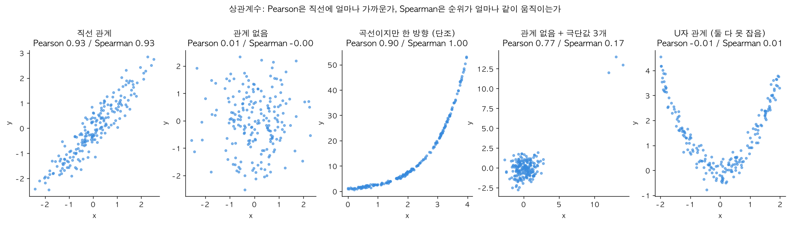

**두 값을 함께 보면 데이터의 모양을 진단할 수 있다**

| 결과 | 뜻 | 위 그림 / 이 과제의 예 |
|---|---|---|
| 둘이 비슷하고 크다 | 직선에 가까운 관계 | 그림 1번 (0.93 / 0.93), 이미지 밝기 평균 – 대비 (−0.82 / −0.84) |
| **Spearman이 더 크다** | 곡선이거나, 극단값이 직선 관계를 가리고 있다 | 그림 3번 (0.90 / 1.00), Quantity – Price (−0.03 / **−0.43**), Frequency – Monetary (0.62 / **0.86**) |
| **Pearson이 더 크다** | 극단값 몇 개가 가짜 관계를 만들었을 수 있다 | 그림 4번: 관계 없는 점들에 극단값 3개만 더해도 **0.77** / 0.17 |
| 둘 다 0 근처 | 관계가 없거나, **한 방향이 아닌 관계**(U자 등) | 그림 2번(정말 관계 없음), 그림 5번(U자: −0.01 / 0.01) |

- 그림 5번처럼 y가 x에 완전히 묶여 있어도 U자 모양이면 두 상관계수가 모두 0에 가깝다. 왼쪽 절반은 반대로, 오른쪽 절반은 함께 움직여 서로 지워지기 때문이다.
- 그래서 **상관계수만 보지 말고 산점도를 함께 본다.**

**상관은 인과가 아니다.** 주문 빈도와 금액이 함께 움직인다고 해서, 빈도를 억지로 늘리면 금액이 반드시 는다는 뜻은 아니다.
- **도매업체**라는 숨은 요인이 둘을 동시에 키웠을 수 있다. 도매업체는 자주 주문하고, 한 번에 많이 산다.
- 이렇게 두 변수에 함께 영향을 주는 제3의 요인을 **교란 변수**(confounder)라고 한다.
- 인과를 확인하려면 A/B 실험처럼 한쪽만 바꿔 보는 방법이 필요하다.

### 6) 이미지는 숫자 표다

흑백 이미지는 칸(픽셀)마다 밝기 숫자가 적힌 표다. 이 과제에서는 0(검정) ~ 1(흰색)로 맞췄다. 80 × 60 이미지 한 장은 숫자 4,800개다.

컬러 이미지는 빨강(R), 초록(G), 파랑(B) 표 3장이다. 흑백으로 바꿀 때는 세 값을 그냥 평균하지 않고, 사람 눈이 초록에 가장 민감하다는 점을 반영한 가중치를 쓴다.

```math
\text{밝기} = 0.299 \times R + 0.587 \times G + 0.114 \times B
```

빨간 픽셀 (R 0.9, G 0.2, B 0.2)의 밝기는 0.269 + 0.117 + 0.023 ≈ 0.41이다.

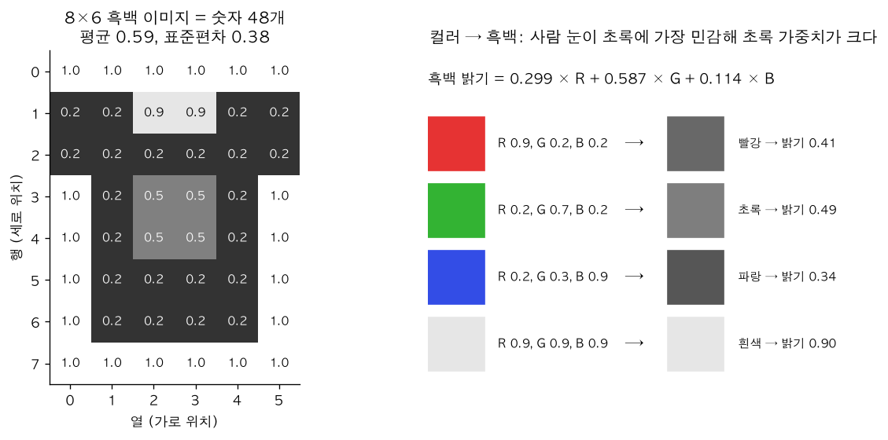

이미지의 **평균**은 전체가 얼마나 밝은지, **표준편차**는 밝은 곳과 어두운 곳이 얼마나 섞여 있는지(대비)를 나타낸다. 왼쪽 그림의 8 × 6 티셔츠는 평균 0.59, 표준편차 0.38이다.

### 7) 배열의 축(axis)과 벡터 연산

이미지 2,000장을 쌓은 배열의 모양(shape)은 (2000, 80, 60)이다. 0번 축은 "몇 번째 이미지", 1번 축은 "세로 위치", 2번 축은 "가로 위치"다.

- `images.mean()`: 숫자 9,600,000개 전체의 평균 하나
- `images.mean(axis=(1, 2))`: 1번·2번 축(세로·가로)을 따라 평균 → **이미지마다 평균 하나씩, 2,000개**
- `images.mean(axis=0)`: 0번 축(이미지 순서)을 따라 평균 → 80 × 60짜리 "평균 이미지" 한 장

반복문으로 2,000장을 하나씩 계산해도 답은 같다(이 과제에서 차이 0.0으로 확인했다). 하지만 NumPy의 **벡터 연산**이 훨씬 빠르고, 코드도 한 줄이다. 명세가 "반복문 대신 배열 연산"을 요구한 이유다.

**얼마나 빠른가** (노트북 4-3절, 2,000장의 밝기 평균, 한 번 실행한 값. 실행마다 조금씩 다르다)

| 방법 | 시간 | 벡터 연산 대비 |
|---|---|---|
| 순수 파이썬 (`sum`으로 픽셀 4,800개 더하기) | 77ms | 약 25배 |
| 반복문 + NumPy (`img.mean()` 2,000번) | 14ms | 약 4.4배 |
| **벡터 연산** (`images.mean(axis=(1, 2))` 1번) | **3.1ms** | 1배 |
| 벡터 연산, 메모리가 띄엄띄엄 놓인 같은 값 | 20ms | 약 6배 |

**왜 빠른가: 세 가지 이유**

1. **해석 비용이 한 번뿐이다.**
   - 파이썬 반복문은 한 바퀴마다 명령을 해석하고, 값의 타입을 확인하고, 결과를 담을 숫자 객체를 새로 만든다.
   - 벡터 연산은 이 일을 한 번만 한다. 나머지 1,920만 번의 덧셈은 C로 짠 반복문이 처리한다.
2. **메모리가 연속이다.**
   - NumPy 배열은 같은 타입의 숫자가 빈틈없이 한 줄로 놓여 있다. `images`는 4바이트 숫자 1,920만 개, 38.4MB다.
   - CPU는 메모리를 64바이트 덩어리(캐시 라인)로 가져온다. 그래서 한 번 가져올 때 숫자 16개를 다 쓴다.
   - 같은 값을 8칸 간격으로 띄엄띄엄 놓은 배열은 덩어리 하나에서 2개만 쓰고 나머지를 버린다. 그래서 같은 계산이 약 6배 느렸다(표의 마지막 줄).
   - 파이썬 리스트는 숫자 객체가 메모리 여기저기 흩어져 있고, 리스트에는 주소만 모여 있다.
3. **CPU가 여러 숫자를 한 명령으로 계산한다 (SIMD).**
   - SIMD는 Single Instruction, Multiple Data의 줄임말이다. 숫자가 한 줄로 붙어 있으면 CPU는 명령 하나로 여러 숫자를 동시에 더한다. 예를 들어 256비트 레지스터면 4바이트 숫자 8개다.
   - NumPy의 합계·평균 내부 반복문은 이 명령을 쓴다. 띄엄띄엄 놓인 배열에서는 쓰기 어렵다.
   - SIMD의 효과만 따로 떼어 잰 값은 아니다. 표의 차이는 세 이유가 합쳐진 결과다.

### 8) 분위수와 순위 점수

**분위수(quantile)** 는 사분위수를 일반화한 것이다. 5등분하면 5분위(quintile)다. RFM 점수는 고객을 값 순서로 세운 뒤 5등분해서, 가장 아래 20%는 1점, 그다음 20%는 2점, …, 가장 위 20%는 5점을 준다.

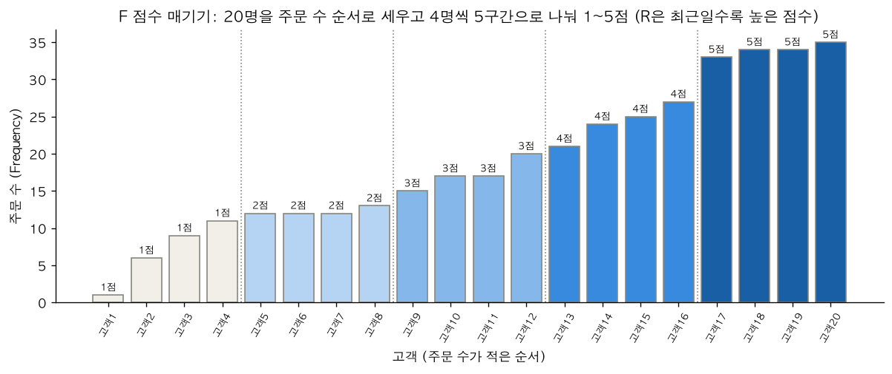

순위로 점수를 매기면 값의 단위(일, 회, 파운드)가 달라도 셋을 같은 1~5점으로 비교할 수 있고, 극단값 한 명이 점수 체계를 흔들지 못한다. 단, Recency는 **작을수록** 좋은 값(최근에 샀음)이라 반대로 매긴다.

### 9) 스케일링: 단위가 다른 값을 같은 눈금으로

**왜 필요한가: 숫자로 먼저 보기**

고객 세 명이 있다. A와 C는 둘 다 최근에 자주 오는 단골이고, B는 1년 가까이 안 온 고객이다.

| 고객 | Recency (일) | Frequency (회) | Monetary (파운드) |
|---|---|---|---|
| A | 10 | 20 | 5,000 |
| B | 300 | 2 | 5,500 |
| C | 12 | 18 | 9,000 |

두 고객이 얼마나 다른지를 **거리**로 잰다. 거리는 각 값의 차이를 제곱해 더한 뒤 제곱근을 씌운 것이다. 피타고라스 정리를 세 방향으로 늘린 것이다.

- A와 B: √(290² + 18² + 500²) = √334,424 ≈ **578**
- A와 C: √(2² + 2² + 4,000²) ≈ **4,000**

숫자만 보면 A는 C보다 B와 훨씬 비슷하다. 하지만 실제로는 A와 C가 같은 종류의 고객이다.
- 금액의 차이(4,000)가 일 수의 차이(290)나 횟수의 차이(18)보다 숫자가 커서, 거리를 혼자 정해 버렸다.
- 금액이 더 중요해서가 아니라, "파운드"라는 작은 단위로 적혀 있어 숫자가 클 뿐이다.

이제 각 값을 **그 값의 표준편차로 나눠** 단위를 없앤다. 이 데이터(고객 5,838명)의 표준편차는 Recency 208.40일, Frequency 12.76회, Monetary 13,841.09파운드다.

| 거리 | Recency 차이² | Frequency 차이² | Monetary 차이² | 거리 |
|---|---|---|---|---|
| A와 B | (290 ÷ 208.40)² = 1.94 | (18 ÷ 12.76)² = 1.99 | (500 ÷ 13,841)² = 0.001 | √3.93 ≈ **1.98** |
| A와 C | (2 ÷ 208.40)² = 0.0001 | (2 ÷ 12.76)² = 0.02 | (4,000 ÷ 13,841)² = 0.08 | √0.11 ≈ **0.33** |

이제 A와 C가 가깝고(0.33), B가 멀다(1.98). 이렇게 단위가 다른 값을 같은 눈금으로 맞추는 일이 **스케일링**이다. **정규화**(normalization)라고도 부른다.

**네 가지 방법**: 모두 `(값 − 중심) ÷ 폭` 한 줄이고, 방법마다 중심과 폭만 다르다.

| 방법 | 중심 | 폭 | 숫자 예시: 1, 2, 3, 4, 100 |
|---|---|---|---|
| 표준화 (standard, z-score) | 평균 22 | 표준편차 43.6 | −0.48, −0.46, −0.44, −0.41, **1.79** |
| Min-Max | 최솟값 1 | 최댓값 − 최솟값 = 99 | 0, 0.01, 0.02, 0.03, **1** |
| 로버스트 (robust) | 중앙값 3 | IQR = 4 − 2 = 2 | −1, −0.5, 0, 0.5, **48.5** |
| 로그 | - | - | log₁₀(1 + 값) = 0.30, 0.48, 0.60, 0.70, **2.00** |

- **Min-Max**: 극단값 100 하나 때문에 나머지 넷이 0 ~ 0.03에 몰린다.
- **로버스트**: 기준(중앙값, IQR)은 극단값에 흔들리지 않지만, 극단값 자체는 48.5로 크게 남는다.
- **로그**: 100배 차이를 2칸 차이로 줄인다. 예시는 log₁₀으로 계산했고, 코드(`np.log1p`)는 자연로그를 쓴다. 밑이 달라도 값 전체에 같은 수가 곱해질 뿐이라 모양은 같다.

이 과제에서 이미 쓴 스케일링도 있다.
- **픽셀 값 ÷ 255**: 0 ~ 255 범위를 0 ~ 1로 맞췄다. 범위가 정해진 값이라 Min-Max와 같은 생각이다.
- **거래 금액의 로그 축**: 그림에서 쓴 로그 변환이다.
- **RFM 5분위 점수**(위 8번): 값 대신 순위를 쓰는 스케일링이다.

## 개념 설명: 왜 이렇게 분석했나

각 단계에서 무엇을 왜 그렇게 했는지, 이 과제의 실제 수치로 설명한다. 계산 코드는 `src/pipeline.py`, 결과는 `notebooks/analysis_report.ipynb`에 있다.

### 1. 탐색: 먼저 들여다본다

Tukey가 말한 EDA의 핵심은 **계산하기 전에 보라**는 것이다. `info()`, `describe()`, `head()` 세 줄만으로도 이 데이터의 문제가 드러났다.

| 본 것 | 발견 | 그래서 한 일 |
|---|---|---|
| `describe()`의 `Quantity` 최솟값 −80,995, 최댓값 80,995 | 같은 크기의 주문과 취소가 있다 | 취소 주문을 따로 다룸 (개념 설명 7) |
| 평균 9.94, 중앙값 3 | 꼬리가 긴 분포 | 중앙값을 대표값으로, 로그 축으로 그림 |
| `info()`의 `Customer ID` 824,364 / 1,067,371 | 고객 번호 22.8%가 빔 | RFM에서 제외 (개념 설명 2) |
| `Price` 최솟값 −53,594 | 상품이 아닌 회계 조정 기록 | 단가 0 이하 행 제외 |

이걸 보지 않고 바로 평균 매출이나 RFM을 계산했다면, 취소된 8만 개 주문이 매출로 잡히는 잘못된 결론이 나왔을 것이다.

### 1-1. 전처리 기준: 무엇을 빼고 무엇을 남기나

"이상한 값"은 성격이 다른 두 종류로 나눠서 다룬다.

| 종류 | 뜻 | 이 데이터의 예 | 다루는 법 |
|---|---|---|---|
| **규칙 위반** | 데이터의 뜻으로 볼 때 판매 기록이 될 수 없는 행 | 완전 중복, 배송비·수수료 코드, 취소 주문, 단가 0 | 근거를 남기고 **빼거나 따로 다룬다** |
| **통계적 이상치** | 있을 수 있지만 드문 값 | 9,360개짜리 도매 주문 | **정체를 확인한 뒤** 판단한다 ([개념 설명 3](#3-이상치-지우기-전에-정체부터-본다)) |

**순서가 중요하다.** 규칙 위반을 먼저 정리한 뒤에 통계적 이상치를 찾는다. 규칙 위반이 섞인 채로 Q1, Q3를 계산하면 이상치를 판단하는 기준 자체가 오염되기 때문이다. 처음 분석에서는 비상품 코드를 빼지 않아 `Manual`(수동 조정, 25,111.09파운드)이 "가장 큰 이상치" 목록에 올라 있었다.

**전처리 기준표**

| 규칙 | 해당 행 | 근거 | 처리 | 적용 범위 |
|---|---|---|---|---|
| 완전 중복 (모든 열이 같음) | 34,335 | 22,844행이 2010-12-01 ~ 09에 몰림. 원본 엑셀의 2009~2010년 시트와 2010~2011년 시트가 이 기간을 **겹쳐 담았다.** 나머지 약 1만 1천 행은 같은 주문 안의 반복 줄로, 실제 두 번 산 것과 입력 반복을 구분할 근거가 없다 | 하나만 남기고 삭제 | 모든 분석 |
| 상품이 아닌 코드 | 5,801 (26종) | 배송비, 수수료, 회계 조정, 할인, 샘플, 상품권, 테스트 상품은 상품 판매가 아니다 | 삭제 | 모든 분석 |
| 취소 주문 (`Invoice`가 C로 시작) | 17,915 | 판매가 아니라 앞선 구매를 되돌린 기록 | 판매 분석에서 제외, RFM에서는 금액에서 차감 | 판매 분석, RFM |
| 단가 0 이하 | 5,963 | 판매 금액이 0. 이 중 3,391행은 취소가 아닌데 수량이 0 이하인 **재고 조정**(설명: damages, check, missing 등, 고객 번호 없음) | 판매 분석에서 제외 | 판매 분석, RFM |
| 상품명 결측 | 4,239 | 모두 단가 0인 내부 기록 | 같은 상품 코드의 최빈 상품명으로 대치 | 텍스트 피처 |
| 고객 번호 결측 | 232,991 (22.7%) | 다른 열로 추정할 수 없다 | 채우지 않음 | RFM에서만 제외 |

행 수는 이렇게 줄어든다: 원본 1,067,371행 → 중복 제거 1,033,036행 → 비상품 코드 제외 1,027,235행 → 판매 분석용(취소·단가 0 이하 제외) 1,003,357행.

**비상품 코드를 고른 기준**: 이 데이터에서 상품 코드는 숫자 5자리로 시작한다(예: `85048`, `79323P`). 숫자로 시작하지 않는 코드 62종을 하나씩 확인해서, 실제 상품인 `DCGS…`(반려동물·파티 용품), `PADS`(쿠션 패드), `SP1002`(어린이 이젤)는 남기고 나머지 26종을 뺐다.

| 이유 | 코드 | 행 수 |
|---|---|---|
| 우편료, 운송비 | `POST`, `DOT`, `C2`, `C3` | 3,789 |
| 수동 입력 | `M`, `m` | 1,392 |
| 할인, 샘플 | `D`, `S` | 274 |
| 상품권 | `GIFT`, `gift_0001_10` ~ `gift_0001_90` | 101 |
| 수수료 | `BANK CHARGES`, `AMAZONFEE`, `CRUK` | 152 |
| 회계 조정 | `ADJUST`, `ADJUST2`, `B` | 76 |
| 테스트 상품 | `TEST001`, `TEST002` | 17 |

목록과 이유는 `src/pipeline.py`의 `NON_PRODUCT_CODES`에 그대로 적어 두었다. 우편료는 고객이 실제로 낸 돈이라 매출에 넣을 수도 있다. 이 분석은 "어떤 상품을 누가 얼마나 사는가"를 보려는 것이라 뺐다.

**정리가 결과를 얼마나 바꿨나**

- 중복 때문에 2010년 12월 매출이 126만 파운드로 부풀어 있었다. 중복만 지워도 82만 파운드가 되고, 비상품 코드까지 빼면 78만 파운드다. 한 달 매출이 50% 넘게 두 번 세어지고 있었던 셈이다.
- RFM 결론(VIP가 매출의 약 70%)은 거의 그대로였다. VIP 매출 비중은 정리 전 69.4%, 정리 후 69.1%다. 고객 번호가 있는 거래에서는 중복과 비상품 코드의 비중이 작았기 때문이다.

### 2. 결측치: 왜 비었는지부터 생각한다

값이 빈 이유에 따라 처리 방법이 달라진다. Rubin이 제시한 틀로 보통 세 가지로 나눈다.

| 종류 | 뜻 | 예 | 처리 |
|---|---|---|---|
| **MCAR** (완전 무작위 결측) | 비는 것이 어떤 값과도 상관없이 우연 | 서버 오류로 무작위 행이 빠짐 | 빼도 결과가 치우치지 않는다 |
| **MAR** (무작위 결측) | 비는 것이 **관측된 다른 변수**와 관련 | 단가 0인 내부 기록에서만 상품명이 빔 | 관련 변수로 그룹을 나눠 채울 수 있다 |
| **MNAR** (비무작위 결측) | 비는 것이 **그 값 자체**와 관련 | 큰 손님일수록 고객 번호를 안 남긴다면 | 채우면 오히려 왜곡된다. 원인 데이터가 필요하다 |

**상품명(`Description`) 4,239칸**: 결측 행의 단가가 모두 0이었다. 관측된 변수(단가)와 관련된 결측이다. 그리고 같은 상품 코드(`StockCode`)는 같은 상품이므로, **같은 코드의 가장 흔한 상품명으로 채우는 그룹별 대치**가 자연스럽다. 3,882칸을 이렇게 채웠다. 전체 최빈값("WHITE HANGING HEART T-LIGHT HOLDER" 같은 것)으로 채웠다면 엉뚱한 상품명이 들어갔을 것이다. 이것이 그룹별 대치가 전체 대치보다 나은 이유다.

**그룹별 대치의 대가: 분산 축소와 그룹 차이 과장**

채운 값은 진짜 값이 아니라 그룹의 **대표값**이다. 그래서 대치한 뒤의 데이터는 실제보다 덜 퍼져 보인다.

얼마나 달라지는지 숫자 열로 실험했다(노트북 3-2절). 판매 데이터의 `Price`는 결측이 없으므로, 10%(100,018칸)를 일부러 지우고 두 방법으로 채운 뒤 원래 값과 비교했다.

| | 전체 표준편차 | 같은 상품 안의 흩어짐 | 상품끼리의 차이 | 채운 칸의 평균 오차 |
|---|---|---|---|---|
| 원래 값 | 4.75 | 0.69 | 7.99 | - |
| 전체 중앙값으로 채움 | **4.55** | 0.79 | **7.13** | 2.15파운드 |
| 같은 `StockCode`의 중앙값으로 채움 | 4.72 | **0.66** | **8.01** | **0.58파운드** |

- 표에서 "같은 상품 안의 흩어짐"은 상품별 표준편차의 중앙값이다. "상품끼리의 차이"는 상품별 평균값들의 표준편차다.
- **전체 대치의 문제**:
  - 빈칸이 모두 같은 숫자가 되어 전체 표준편차가 4.75 → 4.55로 줄었다. 분산으로는 약 8% 줄었다.
  - 비싼 상품의 빈칸이 싼 값으로 채워져서 상품끼리의 차이도 7.99 → 7.13으로 흐려졌다.
- **그룹 대치는 오차가 1/4로 훨씬 정확하다. 하지만 세 가지 위험이 남는다.**
  1. **분산 축소**: 같은 상품 안의 흩어짐이 0.69 → 0.66으로 줄었다.
     - 같은 상품의 빈칸이 모두 같은 중앙값이 되면서, 할인이나 대량 구매 단가 같은 실제 가격 변동이 지워진다.
     - 이 열로 표준편차를 계산하면 실제보다 작게 나오고, 상관계수도 실제와 달라진다.
  2. **그룹 차이 과장**: 상품끼리의 차이가 7.99 → 8.01로 커졌다.
     - 각 그룹이 자기 대표값 쪽으로 모여서, 그룹 사이가 실제보다 또렷해 보인다.
     - 결측이 10%라서 이번 차이는 작지만, 결측 비율이 커질수록 커진다.
  3. **작은 그룹의 불안정**: 그룹에 남은 값이 1~4개면 평균 오차가 1.02파운드, 100개 이상이면 0.55파운드로 거의 2배다.
     - 값이 1개뿐인 그룹은 그 하나가 대표값이 된다.
     - 남은 값이 0개인 16칸은 아예 채우지 못했다.
- **이번 분석에 미친 영향**: 실제로 그룹 대치한 열은 `Description`(상품명, 글자)이다. 글자에는 분산이 없고, 그 행들은 단가 0이라 판매 분석에서 빠진다. 그래서 위 위험은 이번 결과 수치에 영향을 주지 않는다.
- **숫자 열을 그룹 대치할 때의 규칙**:
  - 대치한 칸을 표시하는 열을 남긴다.
  - 값이 몇 개 안 되는 그룹은 전체 값으로 채운다.
  - 분산이나 상관을 볼 때는 대치 전과 후를 함께 본다.

**고객 번호(`Customer ID`) 232,991행**: 고객 번호는 다른 열로 추정할 방법이 없다. 평균이나 최빈값으로 채우면 가짜 고객이 생기거나 한 고객에게 수만 건이 몰린다. 그래서 **채우지 않고 RFM에서만 뺐다.** 비회원 구매인지, 큰 거래처가 번호를 안 남긴 것인지(MNAR) 이 데이터만으로는 알 수 없다. 그래서 RFM 결과는 매출의 약 86%만 대표한다는 한계를 함께 적었다.

### 3. 이상치: 지우기 전에 정체부터 본다

**이상치 후보 고르기: 어느 열을 검사하나**

이상치 검사는 **값의 크기에 뜻이 있는 열**에만 한다.

| 열 | 검사하나 | 이유 |
|---|---|---|
| `Quantity`, `Price`, `amount` | **한다** | 크기가 곧 뜻이다. 10개와 10,000개는 다른 거래다 |
| `Customer ID`, `StockCode`, `Invoice` | 하지 않는다 | 숫자처럼 보여도 이름표다. 고객 번호 18008이 12346보다 "크다"는 말에는 뜻이 없다 |
| `InvoiceDate` | 범위만 확인 | 데이터 기간(2009-12-01 ~ 2011-12-09) 밖의 날짜가 없는지만 본다 |
| `Country`, `Description` | 빈도만 확인 | 범주는 크기가 없으므로 IQR이 아니라 "드물게 나오는 값"을 본다 |

수치 열 중에서도 `amount`(= 수량 × 단가)를 중심으로 본다. 수량만 크거나 단가만 높은 거래보다, **금액이 큰 거래가 매출 분석과 RFM에 직접 영향을 주기 때문이다.**

**이상치 기준: 왜 IQR 1.5배인가**

같은 거래 금액에 여러 기준을 적용해 보면 각 기준의 성격이 드러난다(노트북 5-1절).

| 기준 | 경계 (파운드) | 이상치 행 수 | 비율 |
|---|---|---|---|
| z-score > 3 (평균 ± 3 × 표준편차) | −580.37 ~ 619.52 | 1,396 | 0.14% |
| IQR 1.5배 | −16.23 ~ 38.06 | 82,136 | 8.19% |
| IQR 3배 | −36.58 ~ 58.41 | 52,211 | 5.20% |
| 로그 금액에 IQR 1.5배 | 0.47 ~ 157.04 | 19,471 | 1.94% |

- **z-score가 거의 못 잡는 이유**: 거래 금액은 평균 19.58파운드인데 표준편차가 199.98파운드다. 극단값이 기준을 만드는 평균과 표준편차를 부풀려서, 경계가 −580 ~ 620파운드처럼 넓어진다. **기준이 이상치에 오염되는 것**이다. z-score는 데이터가 정규분포에 가까울 때 쓰는 기준이다.
- **IQR이 맞는 이유**: Q1과 Q3는 가운데 50%로만 정해지므로, 맨 끝의 값이 아무리 커도 기준이 흔들리지 않는다. 명세가 IQR을 요구한 이유이기도 하다.
- **1.5배와 3배**: Tukey는 1.5 × IQR 밖을 "바깥 값(outside)", 3 × IQR 밖을 "아주 먼 값(far out)"으로 나눴다. 이 데이터는 꼬리가 길어 3배로 넓혀도 5% 넘게 남는다.
- **로그 IQR**: 금액처럼 "몇 배 차이"가 의미 있는 값은 로그로 바꾸면 분포가 대칭에 가까워진다. 그래서 로그 IQR(1.94%)이 "정말 드문 거래"에 더 가깝다. 이 과제는 명세에 맞춰 보통 축의 IQR 1.5배로 탐지했고, 기준을 정하기 전에 여러 기준을 비교해 데이터의 꼬리가 얼마나 긴지 확인했다.

**찾은 이상치의 정체**

IQR 규칙은 "드문 값"을 찾아 줄 뿐, 그 값이 **틀린 값**인지는 알려 주지 않는다.

| 이상치 | 정체 | 판단 |
|---|---|---|
| 80,995개 주문 (168,469.60파운드) | 바로 취소된 주문 | 취소와 상쇄해야 한다 (RFM 순 구매 금액) |
| 74,215개 주문 (77,183.60파운드) | 역시 취소된 주문 | 같음 |
| `Manual` 25,111.09파운드 | 상품이 아닌 수동 조정 | 이상치가 아니라 규칙 위반. 전처리에서 비상품 코드로 이미 뺐다 (1-1) |
| 수량 24개 이상 주문 다수 | 도매 고객의 정상 주문 | **지우면 안 된다** |

이 쇼핑몰은 도매 고객이 많아 1.5 × IQR 기준으로 거래 금액의 8.19%가 이상치로 잡혔다. 3 × IQR(Tukey의 "아주 먼 값" 기준)로 넓혀도 5.20%가 남는다. 이걸 모두 지우면 VIP의 실제 매출을 지우는 셈이다.

그래서 이렇게 나눴다.
- **분포를 보는 그림용 사본**: 경계값(38.06파운드)으로 잘라 붙임(clip). 행은 그대로 둔다.
- **RFM 금액**: 원래 값을 쓰되, 취소는 빼서 순 구매 금액으로 계산한다.

**잘라 붙이기(clip)와 지우기(remove)의 차이**: clip은 행 수를 유지하고 값만 경계로 당긴다. remove는 행 자체를 없앤다. 고객 수를 세거나 매출 합을 낼 때 remove는 결과를 바꾸고, clip은 합계를 줄인다. 둘 다 "분포를 보기 위한" 처리이지, 원본 데이터를 고치는 처리가 아니다.

### 4. 피처 엔지니어링: 숫자가 아닌 것을 숫자로

통계나 모델은 숫자만 계산할 수 있다. 사진과 글을 그대로는 평균 낼 수 없으니, 그 특징을 숫자 열로 만든다. 이것이 **피처 엔지니어링**이다.

| 원래 데이터 | 만든 피처 | 무엇을 담나 | 이 과제의 값 |
|---|---|---|---|
| 상품 이미지 | `img_mean` | 전체 밝기 (흰 배경이 많으면 큼) | 평균 0.84 |
| 상품 이미지 | `img_std` | 대비 (어두운 상품이 흰 배경 위에 크게 있으면 큼) | 평균 0.25 |
| 상품명 | `name_word_count`, `name_char_length` | 이름의 길이 | 평균 5.73단어, 34.35글자 |
| (보너스) 이미지 | 밝기 히스토그램 8구간 | 어두운·중간·밝은 픽셀의 비율 | 흰 배경 비율: 의류 0.62, 화장품류 0.86 |
| (보너스) 이미지 | `edge_strength` | 윤곽·무늬가 많은 정도 | 의류 0.06, 화장품류 0.03 |

`img_mean`과 `img_std`의 상관이 −0.82로 강했다. 흰 배경이 많은 사진은 대비도 작기 때문이다. 두 피처가 거의 같은 정보를 담고 있다는 뜻이므로, 나중에 모델에 넣을 때는 하나만 쓰거나 다른 피처(엣지, 히스토그램)를 더해야 정보가 늘어난다.

**엣지 세기**는 옆 픽셀과의 밝기 차이로 구한다. 밝기가 갑자기 바뀌는 곳이 윤곽이다. 가로 차이 dx와 세로 차이 dy가 있으면 그 점의 기울기 크기는 √(dx² + dy²)이고, 이를 이미지 전체에서 평균 낸다. 미분(기울기)을 이웃 칸의 차이로 계산하는 것과 같은 원리다.

**이미지가 많아지면: 병목과 대응** (노트북 4-4절)

어느 단계가 먼저 느려지는지 단계별로 쟀다. 값은 한 번 실행한 값이다.

| 단계 | 1장당 시간 | 비고 |
|---|---|---|
| 파일 읽기 + JPG 디코딩 (`plt.imread`) | 약 0.23ms | 가장 느린 계산 단계 |
| `load_images` 전체 (디코딩 + 흑백 + 자르기) | 약 0.27ms | 흑백 변환과 자르기는 0.04ms |
| 같은 디코딩을 스레드 4개로 | 약 0.22ms | 거의 빨라지지 않는다 |
| 피처 계산 (평균, 벡터 연산) | 약 0.0015ms | 디코딩의 1/100 이하 |

- **가장 느린 계산은 디코딩**이다. 피처 계산은 벡터 연산이라 거의 시간이 들지 않는다.
- **실제로 가장 오래 걸린 것은 다운로드**(네트워크)였다. 서버가 요청을 잠시 막아서(503) 기다렸다가 다시 시도해야 했다(`scripts/download_data.py`).
- **스레드 병렬화는 효과가 없었다.** 이번 이미지는 이미 80×60으로 줄인 작은 파일이라 한 장의 디코딩이 0.2ms 남짓이다. 일을 나누고 모으는 비용이 아낀 시간과 비슷하다.
- **전체 44,441장으로 늘리면 메모리가 먼저 문제다.**
  - 로드 시간은 약 10~20초로 견딜 만하다.
  - 하지만 float32 배열 하나가 853MB가 된다.

이미지 수와 크기가 커질 때의 대응 방법이다.

| 방법 | 어떻게 | 기대 효과 | 이 과제에서 |
|---|---|---|---|
| 배치 처리 | 2,000장씩 읽어 피처만 남기고 배열은 버린다 | 메모리가 전체 장수와 상관없이 일정하다 (2,000장이면 38MB) | 2,000장이라 한 번에 처리 |
| 다운샘플링 | `load_images(step=2)`로 가로·세로 1/2 | 픽셀 수, 메모리, 계산이 1/4 | 이미 80×60이라 쓰지 않음 |
| 프로세스 병렬화 | `concurrent.futures.ProcessPoolExecutor`로 파일을 CPU 코어에 나눈다 | 큰 원본 사진처럼 디코딩이 오래 걸릴 때 코어 수에 가깝게 빨라진다 | 작은 파일에서는 효과 없음을 측정으로 확인 |
| 표본 추출 | 탐색 단계에서는 일부만 본다 | 시간과 메모리가 표본 비율만큼 준다 | 44,441장 중 2,000장 사용 |

**표본만으로 충분한지 확인**: 표본 평균이 흔들리는 폭은 σ/√n이다. 그래서 표본을 4배로 늘리면 흔들림이 절반이 된다.

- 100장만 써도 밝기 평균의 평균은 0.8345로, 2,000장 전체(0.8354)와 0.001 차이다. 흔들림은 0.008이다.
- 그래서 "흰 배경 사진이 대부분"이라는 결론은 수백 장이면 충분히 나온다. 전체 이미지가 필요한 것은 모델을 학습할 때다.

### 5. 통계와 상관: 요약하고 관계를 잰다

- **대표값**: 거래 금액은 평균(19.58)과 중앙값(10.08)이 두 배 차이 나므로 둘을 함께 보고, "보통 거래"는 중앙값으로 말했다.
- **퍼짐**: 표준편차(199.98)가 평균의 10배다. 몇 건의 거대 거래가 퍼짐을 지배한다는 신호다. 그래서 퍼짐은 사분위수(4.13 ~ 17.70)로도 함께 봤다.
- **상관**: Pearson과 Spearman을 항상 같이 계산했다. 둘이 크게 다르면(`Quantity`–`Price` −0.03 vs −0.43) 극단값이나 곡선 관계가 숨어 있다는 신호다.
- **Spearman 직접 구현**: pandas의 Spearman은 허용 라이브러리가 아닌 SciPy를 부른다. 정의대로 "순위로 바꾼 뒤 Pearson"을 계산하면 되므로 `rank()`와 `corr()`로 직접 구현했다.

**상관 쌍을 고른 이유: 각 쌍이 답하려던 질문**

상관계수는 아무 쌍이나 계산하지 않았다. 쌍마다 확인하려던 질문이 있다(노트북 8절).

| 쌍 | 확인하려던 질문 | Pearson / Spearman | 답 | 어디에 쓰나 |
|---|---|---|---|---|
| Frequency – Monetary | RFM의 F와 M은 서로 다른 정보를 담는가, 아니면 겹치나? | 0.62 / **0.86** | 많이 겹친다. 자주 오는 고객이 돈도 많이 쓴다 | 세그먼트 규칙에서 F와 M을 함께 보는 근거. 빈도를 늘리는 활동(재구매 알림)이 매출로 이어질 가능성 |
| Recency – Frequency | 최근에 온 고객이 자주 오는 고객인가? | −0.26 / **−0.56** | 그렇다. Recency는 작을수록 최근이라 음수가 "함께 좋다"는 뜻이다 | 최근 고객 중에 단골이 많다는 근거. At Risk(예전엔 자주 왔는데 최근에 안 옴)가 눈에 띄는 이유 |
| Quantity – Price | 싸면 많이 사는가? | −0.03 / **−0.43** | 순위로 보면 그렇다. 직선 관계는 극단값에 가려졌다 | 도매 구조(싼 소모품을 대량 구매) 확인. 할인 단가 전략의 근거 |
| img_mean – img_std | 두 이미지 피처가 같은 정보를 담아 겹치나? | −0.82 / −0.84 | 거의 같은 정보다. 흰 배경이 많으면 밝고 대비도 작다 | 모델에 둘 다 넣으면 정보가 늘지 않는다. 하나만 쓰거나 엣지·히스토그램을 더한다 |
| name_word_count – img_std | 텍스트 피처와 이미지 피처는 서로 다른 정보인가? | 0.02 / 0.03 | 관계가 없다 | 두 피처를 함께 쓰면 서로 다른 정보를 더할 수 있다 |

- 첫 세 쌍은 **비즈니스 질문**("누가, 왜 많이 사나")에 답한다.
- 마지막 두 쌍은 **피처 설계 질문**("모델에 무엇을 넣을까")에 답한다. 상관이 아주 강한 두 피처는 같은 정보를 두 번 넣는 셈이고, 상관이 없는 두 피처는 서로를 보완한다.

### 5-1. 스케일링: 언제 어떤 방법을 쓰나

고객 5,838명의 R, F, M 값에 네 방법을 적용했다(노트북 8-1절, `DataAnalyzer.scale()`). 무작위로 고른 고객 2만 쌍의 거리에서 R, F, M이 각각 몇 %를 차지하는지 쟀다. 세 값이 고르게 반영될수록 좋다.

| 방법 | R | F | M | Monetary 범위 | 판단 |
|---|---|---|---|---|---|
| 원래 값 | 0% | 0% | **100%** | 0 ~ 578,409 | 금액이 거리를 혼자 정한다 |
| Min-Max | **98%** | 1% | 1% | 0 ~ 1 (고객 91%가 0.01 미만) | 최댓값 한 명이 기준이 되어 F, M이 0 근처에 몰린다 |
| 로버스트 | 1% | 9% | **90%** | −0.46 ~ 313.74 | 기준은 안 흔들리지만 극단값이 그대로 남는다 |
| 표준화 | 37% | 34% | 28% | −0.20 ~ 41.59 | 평균으로는 고르지만, 극단 고객 몇 명이 끼면 M이 거리를 정한다 |
| **로그 → 표준화** | **33%** | **33%** | **34%** | −4.87 ~ 4.66 | 로그로 꼬리를 줄이고 표준화로 단위를 맞춘다. **꼬리가 긴 RFM에 맞다** |

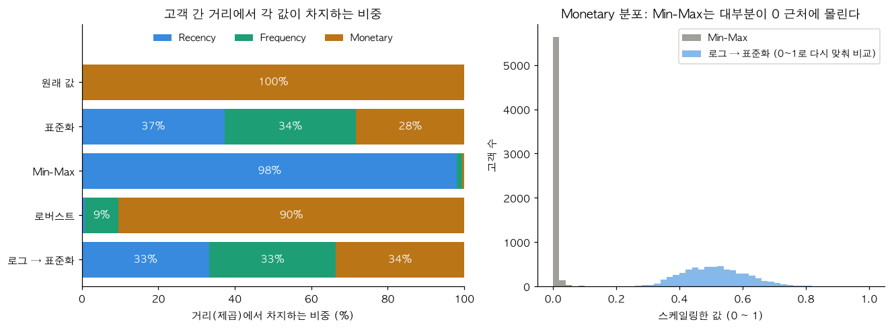

**방법 고르는 기준**

| 데이터 모양 | 맞는 방법 | 이 과제의 예 |
|---|---|---|
| 범위가 정해져 있다 (0 ~ 255 같은) | Min-Max | 픽셀 값 ÷ 255 |
| 정규분포에 가깝고 극단값이 적다 | 표준화 | (이 데이터에는 없음) |
| 극단값이 있지만 값의 크기 차이는 크지 않다 | 로버스트 | - |
| 꼬리가 길고 "몇 배 차이"가 의미 있다 (금액, 횟수) | 로그 → 표준화 | R, F, M |
| 값의 크기보다 순서가 중요하다 | 순위 (분위수 점수) | RFM 1 ~ 5점 |

**스케일링이 필요 없는 경우도 있다.**
- 상관계수는 스스로 단위를 없애는 계산이라, 표준화·Min-Max·로버스트처럼 빼고 나누기만 하는 스케일링으로는 값이 바뀌지 않는다. 로그는 모양을 바꾸므로 Pearson 값이 달라진다.
- 분위수 점수처럼 이미 순위로 바꾼 값도 다시 맞출 필요가 없다.
- 나무 모델(의사결정나무 계열)은 "값이 기준보다 큰가"만 보므로 영향을 거의 받지 않는다.
- **스케일링이 꼭 필요한 곳**은 거리나 기울기를 쓰는 방법이다. 군집화(k-means), 최근접 이웃, 경사하강법으로 학습하는 모델(A2 과제)이 여기에 해당한다.

**데이터 누수를 막는 순서**: 기준(평균, 표준편차 등)은 **학습용 데이터로만** 계산하고, 검증·시험용 데이터에는 그 기준을 그대로 적용한다.
- `scale()`은 계산한 기준을 돌려주므로, 그 기준을 `params`로 넘기면 같은 기준을 다른 데이터에 쓸 수 있다.
- 실험에서 학습용 80%로 기준을 정하고 시험용 20%에 적용했다. 시험용의 평균은 0이 아니라 −0.05 ~ 0.09로 나왔는데, 이것이 정상이다.
- 전체 데이터로 기준을 정하면 시험 데이터의 정보가 학습에 섞인다. [다음 단계: 머신러닝으로 확장](#다음-단계-머신러닝으로-확장)의 이탈 예측 모델도 이 순서를 지킨다.

### 6. 시각화: 질문에 맞는 그래프 고르기

명세의 6종 차트는 각각 다른 질문에 답한다.

| 질문 | 그래프 | 이 과제에서 |
|---|---|---|
| 값이 어떻게 퍼져 있나 | 히스토그램 | 거래 금액(로그), 이미지 밝기 |
| 가운데와 튀는 값은 어디인가 | 박스플롯 | 이상치 처리 전후 |
| 범주별로 얼마나 많나 | 막대그래프 | 세그먼트별 고객 수·매출 비중, 상품 카테고리 |
| 여러 변수 쌍의 관계를 한눈에 | 히트맵 | 상관행렬, R × F 점수표, 코호트 |
| 두 수치가 함께 어떻게 움직이나 | 산점도 | 빈도 × 금액, 밝기 평균 × 표준편차 |
| 시간에 따라 어떻게 변하나 | 라인차트 | 월별 매출과 고객 수 |

꼬리가 긴 값은 로그 축으로, 범주가 섞인 산점도는 색으로 구분하고, 겹치는 점은 투명도(alpha)를 낮췄다.

### 7. RFM: 누가 단골인가

**R(최근성)**, **F(빈도)**, **M(금액)** 세 가지만으로 고객을 나누는 이유는 단순하다. 우편 카탈로그 시절 마케터들이 경험으로 확인한 것은 "최근에 산 사람이, 자주 산 사람이, 많이 쓴 사람이 다음에도 산다"는 것이었다. 고객 정보가 거래 기록밖에 없어도 계산할 수 있다는 점도 크다.

이 과제에서 정한 것들:

- **기준일**: 마지막 거래일(2011-12-09) 다음 날 0시인 2011-12-10. 모든 거래가 기준일보다 앞에 오도록 하루 뒤로 잡았다. Recency는 "며칠이 지났나"를 일 단위로 버림해 세므로, 마지막 날(12월 9일 낮) 산 고객은 0일이 된다.
- **Frequency는 주문 수**: 같은 주문(`Invoice`)에 상품이 30줄 있어도 1번으로 센다. 행 수로 세면 한 번에 여러 상품을 사는 도매 고객의 빈도가 부풀려진다.
- **Monetary는 순 구매 금액**: 구매 금액에서 취소 금액을 뺐다. 취소를 무시하면 80,995개를 주문했다가 전부 취소한 고객이 VIP로 잡힌다. 실제로 2,408명의 금액이 취소만큼 줄었고, 취소가 구매보다 많은 14명은 제외했다.
- **5분위 점수 + 규칙**: 점수를 매긴 뒤 "R·F·M 모두 4 이상이면 VIP" 같은 규칙을 위에서부터 적용했다. 규칙의 순서가 중요하다. VIP 조건을 맞는 고객이 Loyal 조건도 맞기 때문에, 위에 있는 규칙이 먼저 이름을 가져간다.

**파레토 법칙과의 연결**: 결과는 VIP 21.8%가 매출 69.1%를 냈다. 정확히 80/20은 아니지만 "소수가 대부분"이라는 같은 모양이다. 아래는 가상의 고객으로 그린 파레토 곡선이다. 곡선이 왼쪽 위로 많이 휠수록 매출이 소수에게 몰려 있다.

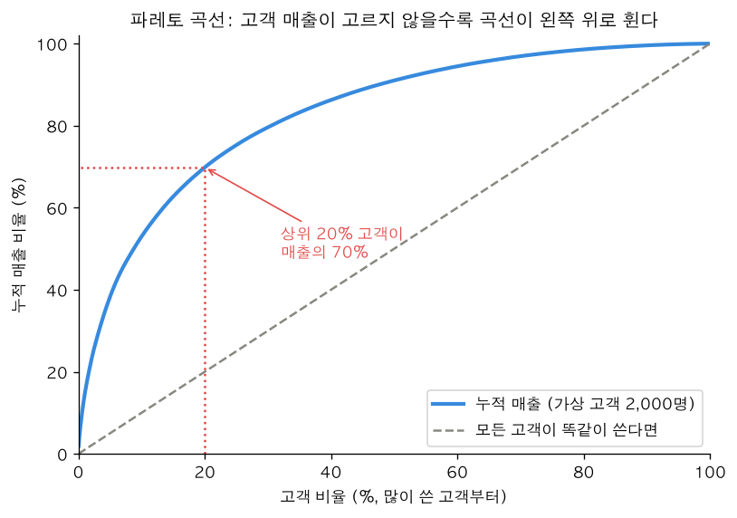

**RFM의 한계**: 과거 거래만 보고 앞으로의 행동을 직접 예측하지는 않는다. 또 점수 구간과 세그먼트 규칙은 분석가가 정하는 것이라, 규칙을 바꾸면 세그먼트 크기가 달라진다. 이후 머신러닝 과제에서 이런 규칙 대신 군집화(clustering)로 고객을 나누는 방법을 배운다.

### 8. 코호트: 시간이 지나도 다시 오는가

**코호트**는 같은 시기에 같은 경험을 한 집단이다. 여기서는 "같은 달에 처음 산 고객"이다. 코호트로 나누면 "고객이 계속 바뀌는" 효과와 "시간이 지나 고객이 떠나는" 효과를 나눠 볼 수 있다.

```math
\text{k개월 뒤 재구매율} = \frac{\text{첫 구매 k개월 뒤에도 산 고객 수}}{\text{코호트의 전체 고객 수}}
```

2010년 12월 코호트는 76명이고, 1~6개월 뒤 재구매율은 평균 7.9%였다. 다른 달 코호트 평균 19.6%보다 훨씬 낮다.

**왼쪽 잘림(left censoring)에 주의**: 데이터는 2009년 12월에 시작한다. 그 전부터 거래하던 단골도 데이터에서는 "2009년 12월에 처음 산 고객"으로 보인다. 그래서 2009-12 코호트(951명)의 재구매율이 35~50%로 유독 높다. 신규 고객이 아니라 기존 단골이 섞였기 때문이다. 같은 이유로 오른쪽 끝(2011년 가을 이후 코호트)은 관측 기간이 짧아 칸이 비어 있다. 데이터의 시작과 끝이 결과를 왜곡할 수 있다는 점은 코호트 분석에서 항상 확인해야 한다.

## 할 일

명세의 기능 요구 사항이다. 끝낸 항목은 `[x]`로 바꾼다.

### 1. 데이터 로드 및 기본 탐색

분석할 데이터를 고르고, 어떤 컬럼이 있고 값이 어떻게 생겼는지 먼저 살펴보는 단계다.

- [x] 최소 1,000건 이상, 8개 이상의 컬럼을 가진 이커머스 데이터셋을 사용한다.
- [x] 수치형, 범주형, 날짜형, 이미지(배열) 중 최소 3가지 이상의 데이터 유형이 포함되도록 한다.
- [x] `info()`, `describe()`, `head()`를 활용하여 데이터 구조를 파악하고 마크다운으로 해석을 작성한다.
- [x] RFM 계산용 거래 데이터는 최소 `customer_id`, `order_date`, `amount`(또는 `price*qty`) 컬럼을 포함하게 한다.
- [x] Recency 기준일을 데이터의 최종 거래일(또는 분석 기준일)로 정의한다.
- [x] 해석에 수치 근거 1개 이상 + 시사점 1문장 이상을 포함한다.

### 2. 분석 파이프라인 모듈화 (OOP)

분석 과정을 하나의 클래스(Class, 데이터와 기능을 묶은 설계도)로 만들어 다른 데이터에도 다시 쓸 수 있게 한다.

- [x] 분석 로직을 `DataAnalyzer`라는 Class로 구현한다.
- [x] 최소 `load_data()`, `handle_missing_values()`, `detect_outliers()`, `calculate_rfm()` 메서드를 포함한다.
  - 메서드 이름은 명세 그대로 `handle_missing_values()`다(명세 PDF의 필수 메서드 목록과 Class 예시 모두 이 이름). 짧은 이름 `handle_missing()`으로 불러도 같은 메서드가 실행되도록 별칭을 두었다(`src/pipeline.py`).
- [x] 주요 파라미터(예: 이상치 임계값, 결측치 대치 전략)를 메서드의 인자로 받도록 설계한다.

### 3. 멀티 모달 데이터 피처 엔지니어링

이미지와 텍스트처럼 바로 계산하기 어려운 데이터를 숫자 컬럼(피처, 모델이나 분석에 쓰는 특성)으로 바꾼다.

- [x] 이미지 데이터: NumPy를 활용하여 각 이미지의 평균(Mean)과 표준편차(Std)를 계산하고 새로운 컬럼으로 추가한다.
- [x] 이미지 피처 계산에 반복문(for loop) 대신 배열 연산을 사용한다.
- [x] 텍스트 데이터: 상품명에서 단어 수(Word Count) 또는 문자열 길이를 계산하여 파생 변수로 추가한다.

### 4. 결측치 및 이상치 처리

비어 있는 값(결측치)을 채우고, 다른 값들과 동떨어진 값(이상치)을 찾아낸다. IQR은 데이터 가운데 50%가 퍼진 폭(3사분위수 − 1사분위수)이다.

- [x] 결측치 현황을 파악한다.
- [x] 그룹별(GroupBy) 통계를 활용한 대치 로직을 1가지 이상 적용한다.
- [x] IQR 방식의 이상치 탐지 로직을 직접 함수로 구현한다.
- [x] 이상치 처리 전후의 분포 변화를 시각화한다.

### 5. 통계 분석

대표값과 퍼짐 정도, 두 변수가 함께 움직이는 정도(상관계수, -1에서 1 사이 값)를 계산하고 뜻을 해석한다.

- [x] 주요 수치형 변수에 대해 평균, 중앙값, 표준편차, 사분위수를 계산하고 해석한다.
- [x] 최소 2쌍 이상의 변수에 대해 상관계수를 계산하고 해석한다.
- [x] 모든 해석에 수치 근거 1개 이상을 포함하고 시사점 1문장 이상을 기술한다.

### 6. 시각화

아래 6가지 유형의 차트를 각각 1개 이상 그린다.

- [x] 히스토그램: 수치형 변수의 분포
- [x] 박스플롯: 이상치 처리 전후 비교
- [x] 막대그래프: 범주형 변수의 빈도 또는 RFM 세그먼트별 고객 수
- [x] 히트맵: 상관행렬 또는 RFM 세그먼트 분포
- [x] 산점도: 두 수치형 변수의 관계
- [x] 라인차트: 시계열 추세 (예: 월별 매출 추이)
- [x] 모든 차트에 제목과 축 레이블을 포함한다.

### 7. RFM 기반 고객 세분화

고객마다 "얼마나 최근에, 얼마나 자주, 얼마나 많이" 샀는지 점수를 매기고, 비슷한 고객끼리 묶는다.

- [x] 거래 데이터를 바탕으로 고객별 Recency, Frequency, Monetary 점수를 계산한다.
- [x] 고객을 최소 4개 그룹(예: VIP, Loyal, New, Churned)으로 세분화한다.
- [x] 각 그룹의 특징을 분석한다.
- [x] 세분화 결과를 바탕으로 비즈니스 관점의 인사이트를 README.md에 정리한다.

### 8. README.md 비즈니스 인사이트

README.md에 비즈니스 인사이트를 3가지 이상 쓰고, 각 인사이트에 아래 3가지 요소를 모두 넣는다.

- [x] 비즈니스 인사이트를 3가지 이상 작성한다.
- [x] (근거) 인사이트를 뒷받침하는 수치/그래프 1개 이상
- [x] (실행) 제안 액션의 대상 세그먼트 + 실행 방법 + 기대 효과
- [x] (검증) "추가로 필요한 데이터" 또는 "반증 가능성" 1문장

## 보너스 과제

### 보너스 1. 이미지 고급 피처 추출

이미지의 심층적인 수치화 방법을 경험한다.

- [x] 이미지의 히스토그램 분포나 간단한 엣지 특성을 NumPy로 직접 계산하여 피처로 추가한다.

### 보너스 2. 코호트 분석 (Cohort Analysis)

시간에 따른 고객 행동 변화를 추적하는 분석 기법을 경험한다. 코호트는 같은 시기에 가입한 고객 묶음이다.

- [x] 가입 월별 고객의 재구매율(Retention Rate)을 계산한다.
- [x] 재구매율을 히트맵으로 시각화한다.

### 보너스 3. 인터랙티브 시각화

동적 시각화의 장점을 경험한다. 이 보너스에 한하여 Plotly 사용이 허용된다.

- [x] Plotly를 활용하여 RFM 세분화 결과를 인터랙티브 차트로 시각화한다.

## 결과 예시 (명세 참고)

명세는 아래가 정답이 아니라 참고 예시이며, 실제 문구와 구조는 달라도 된다고 밝힌다.

- **Class 구조 예시**: `DataAnalyzer(data_path)`에 `load_data()`, `handle_missing_values(strategy='group_mean', group_col=None)`, `detect_outliers(column, threshold=1.5)`, `calculate_rfm(customer_col, date_col, amount_col)`를 두는 형태다. `detect_outliers`는 1사분위수·3사분위수로 IQR을 구하고 `Q1 − threshold × IQR`, `Q3 + threshold × IQR` 밖의 행을 돌려준다. 전체 코드는 명세 PDF의 결과 예시 참고.
- **RFM 세분화 결과 예시**:

| 세그먼트 | 고객 수 | 평균 구매금액 | 특징 |
|---|---|---|---|
| VIP | 120 | 450,000원 | 최근 구매, 높은 빈도, 높은 금액 |
| Loyal | 350 | 180,000원 | 꾸준한 구매, 중간 금액 |
| New | 230 | 85,000원 | 최근 첫 구매, 낮은 빈도 |
| Churned | 300 | 120,000원 | 오래전 마지막 구매, 이탈 위험 |

- **인사이트 예시** (형식만 참고):

```
[인사이트 1]
(근거) Churned 그룹이 전체 고객의 30%를 차지하며, 평균 이탈 기간은 90일임.
(실행) Churned 대상 → 할인 쿠폰 발송 캠페인 → 재구매율 10% 향상 기대.
(검증) 이탈 원인(가격/품질/경쟁사)을 파악하려면 이탈 사유 설문 데이터가 추가로 필요함.
```

명세에는 VIP 그룹을 다룬 [인사이트 2] 예시도 있다.

## 결과 요약

| 항목 | 명세 기준 | 결과 | 통과 |
|---|---|---|---|
| 데이터 건수 | 최소 1,000건 이상 | 거래 1,067,371행, 상품 2,000개 | ✅ |
| 컬럼 수 | 8개 이상 | 거래 8열, 상품 11열 (+ 파생 피처) | ✅ |
| 데이터 유형 수 | 수치형, 범주형, 날짜형, 이미지(배열) 중 최소 3가지 이상 | 4가지 모두 (+ 텍스트) | ✅ |
| `DataAnalyzer` 필수 메서드 | 최소 4개 (`load_data`, `handle_missing_values`, `detect_outliers`, `calculate_rfm`) | 4개 (`handle_missing()` 별칭 포함) + `treat_outliers`, `add_image_features`, `add_text_features`, `summary_stats`, `correlations`, `scale`, `cohort_retention` 등 | ✅ |
| 노트북 실행 | 오류 없이 실행 | 코드 셀 56개 순서대로 실행, 에러 0개 ([outputs/run_log.txt](outputs/run_log.txt)) | ✅ |
| 전처리 기준 | (명세에 없음, 추가) | 완전 중복 34,335행 삭제, 비상품 코드 26종 5,801행 제외, 근거는 개념 설명 1-1 | ✅ |
| 그룹별 결측치 대치 로직 | 1가지 이상 | `Description`을 `StockCode`별 최빈값으로 3,882칸 대치 (`group_mean`, `group_median`도 지원). 그룹 대치의 분산 축소·그룹 차이 과장을 `Price` 실험으로 확인 | ✅ |
| 이미지 피처 | 반복문 없이 배열 연산 | `images.mean(axis=(1, 2))`, 반복문 결과와 차이 0.0, 반복문보다 약 4배·순수 파이썬보다 약 25배 빠름 | ✅ |
| 상관계수 분석 | 최소 2쌍 이상 | 5쌍 (Pearson·Spearman) | ✅ |
| 스케일링 | (명세에 없음, 추가) | `scale()`로 표준화·Min-Max·로버스트·로그 비교. 꼬리가 긴 RFM에는 로그 → 표준화가 R·F·M을 33 : 33 : 34로 고르게 반영 | ✅ |
| 차트 유형 | 6가지 유형 각각 1개 이상 | 히스토그램, 박스플롯, 막대그래프, 히트맵, 산점도, 라인차트 모두 (제목·축 레이블 포함) | ✅ |
| RFM 세그먼트 수 | 최소 4개 그룹 | 6개 (VIP, Loyal, Potential, New, At Risk, Churned) | ✅ |
| README 비즈니스 인사이트 | 3가지 이상, 각각 근거·실행·검증 포함 | 3가지 | ✅ |
| 보너스 | 이미지 고급 피처, 코호트, 인터랙티브 | 3가지 모두 | ✅ |

**명세에서 해석이 필요했던 부분과 처리 방법**

- **이미지 읽기와 Pillow**: `plt.imread()`로 파일을 배열로 읽기만 하고, 흑백 변환·크기 맞추기·통계는 모두 NumPy로 했다. 코드에서 Pillow를 직접 import하지 않았다(아래 "Pillow 사용 기준").
- **코호트의 가입 월**: 가입일 컬럼이 없어 첫 구매 월을 가입 월로 봤다. 데이터가 2009년 12월에 시작하므로 2009-12 코호트에는 그 전부터의 기존 고객이 섞여 재구매율이 높게 나온다.
- **Spearman 상관**: pandas의 Spearman은 허용 라이브러리가 아닌 SciPy가 필요해서, 순위로 바꾼 뒤 Pearson을 계산하는 방식으로 직접 구현했다.

## 명세에서 확인할 점

- **이미지 데이터가 필수인지**: 기능 요구 사항 1은 데이터 유형을 "수치형, 범주형, 날짜형, 이미지(배열) 중 최소 3가지 이상"이라고 해서 이미지가 없어도 되는 것처럼 읽힌다. 그러나 핵심 과제는 "멀티 모달 데이터(수치 + 텍스트 + 이미지 배열)"를 처리한다고 하고, 기능 요구 사항 3은 각 이미지의 평균과 표준편차를 컬럼으로 추가하라고 한다. 실제로는 이미지 배열이 있어야 요구 사항을 모두 채울 수 있다. 또 텍스트(상품명)는 피처 엔지니어링에서 필수인데 데이터 유형 목록에는 없다.
- **데이터 건수·컬럼 수가 어느 데이터에 적용되는지**: 미션 소개는 "상품 데이터"를 분석한다고 하고, RFM에는 `customer_id`, `order_date`, `amount`를 가진 "거래 데이터"가 필요하다. "최소 1,000건 이상, 8개 이상의 컬럼" 기준이 상품 데이터, 거래 데이터, 둘을 합친 데이터 중 어디에 적용되는지 명세에 나와 있지 않다.
- **`imread()`의 출처**: OpenCV, Pillow 등 이미지 처리 전용 라이브러리는 금지인데, 허용 범위에서는 "`imread()` 사용 가능"이라고만 적혀 있다. 허용 라이브러리 중에서는 Matplotlib의 `imread()`로 보이지만 명세가 어느 라이브러리의 함수인지 밝히지 않았다. 게다가 Matplotlib 3.11의 `imread()`는 내부적으로 Pillow를 써서 이미지를 읽으므로, "Pillow 금지"가 직접 import만 금지하는 것인지 확인이 필요하다.
- **코호트 분석의 가입 월**: 보너스 2는 "가입 월별" 재구매율을 요구하지만, 필수 컬럼에는 가입일이 없다. 가입일 컬럼이 없으면 첫 구매월로 대신할 수 있는지 명세에 나와 있지 않다.

## 용어 사전

| 용어 | 쉬운 설명 | 나오는 곳 |
|---|---|---|
| EDA (탐색적 데이터 분석) | 가설을 세우기 전에 데이터를 요약하고 그려 보며 특징을 찾는 일 | 할 일 1, 개념 설명 1 |
| 멀티 모달 데이터 | 숫자, 글, 범주, 날짜, 이미지처럼 형태가 다른 데이터가 섞인 것 | 프로젝트 개요 |
| 수치형 / 범주형 / 날짜형 | 계산할 수 있는 숫자 / 종류를 나타내는 이름표 / 시각 | 데이터 설명 |
| 결측치 | 비어 있는 값. pandas에서는 `NaN`, `<NA>` | 개념 설명 2 |
| MCAR / MAR / MNAR | 값이 빈 이유에 따른 결측의 세 종류: 완전 우연 / 관측된 다른 값과 관련 / 그 값 자체와 관련 | 개념 설명 2 |
| 대치 (imputation) | 결측치를 다른 값으로 채우는 것 | 할 일 4 |
| 그룹별 대치 | 같은 그룹(예: 같은 상품 코드)의 통계값으로 채우는 것. `groupby` + `transform` | 할 일 4 |
| 최빈값 (mode) | 가장 많이 나온 값 | 개념 설명 2 |
| 이상치 (outlier) | 다른 값들과 동떨어진 드문 값. 틀린 값이라는 뜻은 아니다 | 개념 설명 3 |
| 규칙 위반 | 데이터의 뜻으로 볼 때 그 기록이 될 수 없는 행 (중복, 비상품 코드, 취소, 단가 0). 통계적 이상치와 구분해 먼저 정리한다 | 개념 설명 1-1 |
| 완전 중복 | 모든 열의 값이 같은 행 | 개념 설명 1-1 |
| z-score | (값 − 평균) ÷ 표준편차. 평균에서 표준편차 몇 배만큼 떨어졌나. 꼬리가 긴 데이터에서는 기준 자체가 극단값에 오염된다 | 개념 설명 3 |
| 사분위수 (Q1, Q3) | 크기순으로 세운 데이터의 25%, 75% 지점 | 수학·통계 준비 3 |
| IQR (사분위 범위) | Q3 − Q1. 가운데 50%가 퍼진 폭 | 수학·통계 준비 3 |
| clip | 경계 밖 값을 경계값으로 당겨 붙이는 것. 행은 남는다 | 개념 설명 3 |
| 평균 / 중앙값 | 모두 더해 나눈 값 / 줄 세운 가운데 값 | 수학·통계 준비 1 |
| 분산 / 표준편차 | 평균에서 떨어진 정도의 제곱 평균 / 그 제곱근 | 수학·통계 준비 2 |
| 꼬리가 긴 분포 (right-skewed) | 큰 값 쪽으로 길게 늘어진 분포. 평균 > 중앙값 | 수학·통계 준비 1 |
| 로그 축 | 10배마다 같은 간격으로 그리는 축 | 수학·통계 준비 4 |
| 상관계수 | 두 변수가 함께 움직이는 정도. −1 ~ 1 | 수학·통계 준비 5 |
| Pearson / Spearman | 직선에 얼마나 가까운지 / 한 방향으로 함께 움직이는지(순위로 계산) | 수학·통계 준비 5 |
| 공분산 | 평균과의 차이를 서로 곱해 평균 낸 값. +면 함께, −면 반대로 움직인다. 단위에 따라 크기가 바뀐다 | 수학·통계 준비 5 |
| 단조 관계 | 한쪽이 커질 때 다른 쪽이 한 방향으로만 커지는(또는 작아지는) 관계. 곡선이어도 된다 | 수학·통계 준비 5 |
| 교란 변수 (confounder) | 두 변수에 함께 영향을 줘서 상관을 만드는 숨은 요인. 예: 도매업체 → 빈도와 금액 | 수학·통계 준비 5 |
| 피처 (feature) | 분석이나 모델에 쓰는 숫자 열 | 개념 설명 4 |
| 피처 엔지니어링 | 원래 데이터에서 피처를 만들어 내는 일 | 할 일 3 |
| 픽셀 | 이미지를 이루는 작은 칸 하나. 밝기 숫자 하나(흑백) 또는 셋(RGB) | 수학·통계 준비 6 |
| 벡터 연산 (vectorization) | 반복문 없이 배열 전체를 한 번에 계산하는 것 | 수학·통계 준비 7 |
| 축 (axis) | 배열의 방향. (2000, 80, 60)이면 0번 축은 이미지 순서 | 수학·통계 준비 7 |
| 엣지 (edge) | 밝기가 갑자기 바뀌는 곳. 물체의 윤곽 | 개념 설명 4 |
| RFM | 최근성(Recency), 빈도(Frequency), 금액(Monetary)으로 고객을 나누는 방법 | 개념 설명 7 |
| 분위수 / 5분위 | 데이터를 같은 개수로 나누는 지점 / 5등분 | 수학·통계 준비 8 |
| 세그먼트 | 비슷한 고객끼리 묶은 집단 | 할 일 7 |
| 순 구매 금액 | 구매 금액 − 취소 금액 | 개념 설명 7 |
| 파레토 법칙 | 결과의 대부분이 소수의 원인에서 나온다는 경험칙 (80/20) | 개념 설명 7 |
| 코호트 | 같은 시기에 같은 경험(여기서는 첫 구매)을 한 집단 | 개념 설명 8 |
| 재구매율 (retention rate) | 코호트 중 k개월 뒤에도 산 고객의 비율 | 개념 설명 8 |
| 왼쪽 잘림 (left censoring) | 데이터 시작 전의 이력을 볼 수 없어 생기는 왜곡 | 개념 설명 8 |
| 인터랙티브 차트 | 마우스를 올리거나 확대할 수 있는 차트 (Plotly) | 보너스 3 |
| 스케일링 (정규화) | 단위가 다른 값을 같은 눈금으로 바꾸는 것. (값 − 중심) ÷ 폭 | 수학·통계 준비 9, 개념 설명 5-1 |
| 표준화 / Min-Max / 로버스트 | 평균·표준편차 기준 / 최솟값·최댓값 기준(0 ~ 1) / 중앙값·IQR 기준 | 수학·통계 준비 9 |
| 유클리드 거리 | 차이를 제곱해 더하고 제곱근. 피타고라스 정리를 여러 방향으로 늘린 것 | 수학·통계 준비 9 |
| 분산 축소 | 대치한 값이 모두 대표값이라 데이터가 실제보다 덜 퍼져 보이는 현상 | 개념 설명 2 |
| 연속 메모리 | 같은 타입의 숫자가 빈틈없이 한 줄로 놓인 배치. CPU가 한 번에 여러 개를 가져온다 | 수학·통계 준비 7 |
| SIMD | 명령 하나로 여러 숫자를 동시에 계산하는 CPU 기능 | 수학·통계 준비 7 |
| 병목 | 전체 속도를 정하는 가장 느린 단계 | 개념 설명 4 |
| 배치 처리 | 데이터를 일정한 묶음씩 나눠 처리하는 것 | 개념 설명 4 |
| 타깃 (target) | 모델이 맞히려는 값. 여기서는 이탈 여부 `churn` | 다음 단계: 머신러닝으로 확장 |
| 데이터 누수 | 예측 시점에는 알 수 없는 정보(미래 거래)가 피처에 섞이는 것 | 다음 단계: 머신러닝으로 확장 |

## 참고 자료

- 과제 명세: [docs/A1-1.pdf](docs/A1-1.pdf)

**사용한 데이터**

- Chen, D. (2012). Online Retail II [Dataset]. UCI Machine Learning Repository. https://doi.org/10.24432/C5CG6D (CC BY 4.0)
- Param Aggarwal, [Fashion Product Images (Small)](https://www.kaggle.com/datasets/paramaggarwal/fashion-product-images-small), Kaggle (MIT). 이 과제에서는 [Hugging Face 미러 `ashraq/fashion-product-images-small`](https://huggingface.co/datasets/ashraq/fashion-product-images-small)에서 표본을 받았다.
- 그 밖의 후보와 라이선스: [데이터셋 후보](#데이터셋-후보)

**배경과 역사 출처**

- John W. Tukey, *Exploratory Data Analysis* (Addison-Wesley, 1977). 박스플롯과 1.5 × IQR 경계. [Wolfram MathWorld: Box-and-Whisker Plot](https://mathworld.wolfram.com/Box-and-WhiskerPlot.html)
- Charles Spearman, "The Proof and Measurement of Association between Two Things", *The American Journal of Psychology* 15 (1904), 72–101. [원문 PDF](https://www.gwern.net/doc/psychology/1904-spearman.pdf)
- Pareto 원리와 Juran: [Wikipedia: Pareto principle](https://en.wikipedia.org/wiki/Pareto_principle), [J. M. Juran, "The Non-Pareto Principle" (1974)](https://www.juran.com/wp-content/uploads/2021/03/The-Non-Pareto-Principle-1974.pdf)
- Norman B. Ryder, "The Cohort as a Concept in the Study of Social Change", *American Sociological Review* 30 (1965). [재수록본 정보](https://ideas.repec.org/h/spr/sprchp/978-1-4613-8536-3_2.html)
- Donald B. Rubin, "Inference and Missing Data", *Biometrika* 63 (1976). 결측 분류 해설: [Stef van Buuren, *Flexible Imputation of Missing Data*, 1.2절](https://stefvanbuuren.name/fimd/sec-MCAR.html)
- RFM의 역사: Arthur M. Hughes, *Strategic Database Marketing* (1994); Bult & Wansbeek, "Optimal Selection for Direct Mail", *Marketing Science* (1995). 기원에 대한 정리: [DMA: RFM modelling](https://dma.org.uk/article/use-rfm-modelling-to-generate-successful-customer-segments)
- NumPy 1.0 발표 (2006): [NumPy 1.0 release announcement](https://mail.python.org/pipermail/python-list/2006-October/369969.html), [History of NumPy](https://numpy.org/history/)
- pandas의 시작: [Wes McKinney, About](https://wesmckinney.com/about.html)
